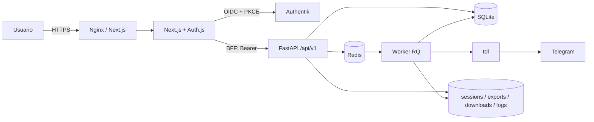

# TDL Console

[English](README.md) | **Español**

Consola web en español para descargar media de Telegram con `tdl`. Next.js presenta la
interfaz y actúa como BFF; FastAPI expone `/api/v1` y concentra la lógica; Redis/RQ ejecuta
los trabajos. SQLite conserva jobs, archivos, plantillas y ajustes; la sesión de Telegram,
los exports, los logs y las descargas viven en el sistema de archivos.

La migración desde la UI Jinja/HTMX está implementada: frontend Next.js 16, API FastAPI,
autenticación con Authentik, worker RQ y dos despliegues independientes (nativo en LXC y
Docker Compose). El login real contra Authentik está verificado en el entorno Docker local.
Quedan pendientes de validación real la instalación en un LXC, el túnel público y las
descargas contra Telegram real.

## Arquitectura



| Componente | Responsabilidad | No hace |
|---|---|---|
| Next.js | Pantallas, formularios, tema, polling, sesión OIDC y BFF | Ejecutar comandos ni leer archivos del servidor |
| FastAPI | API, validación, auth, persistencia y control de procesos | Renderizar HTML de la aplicación |
| Worker RQ | Export por rangos, filtrado, descargas por lotes y borrado | Servir HTTP |
| Redis | Cola de trabajos y tokens de ejecución | Guardar el estado de negocio |
| SQLite | Jobs, archivos, plantillas y ajustes de ejecución | Guardar archivos pesados |
| Sistema de archivos | Sesión de Telegram, exports, filtros, lotes, logs y descargas | Sustituir la base de datos |
| `tdl` | Acceso a Telegram y transferencia de archivos | Ser llamado desde el navegador |
| Authentik | Único proveedor de identidad y política de acceso | Almacenar datos de la aplicación |
| Nginx (Docker) | TLS, rate limit y proxy same-origin | Lógica de negocio |

## Funciones

- Login único con Authentik; el grupo `tdl-admin` autoriza el acceso. No hay contraseñas
  locales ni registro dentro de la app.
- Estado del sistema: sesión de Telegram, binario `tdl`, Redis, worker, almacenamiento y
  versión instalada.
- Chats con caché, búsqueda, tipo, orden, perfil, jobs y limpieza de descargas.
- Nueva descarga con chat, texto, hashtag, fechas, tipo de archivo, plantillas y subcarpeta.
- Export por rangos reanudable, filtrado y descarga por lotes con registro por archivo.
- Progreso honesto: barra indeterminada hasta conocer el total; ETA y velocidad solo cuando
  hay datos fiables.
- Cancelar, reintentar pendientes, reintentar solo fallidos y eliminar con `wipe`.
- Galería y lista de archivos, vista previa segura y descarga.
- Eventos y logs por job, búsqueda global, resumen y registros.
- Configuración editable: carpeta de descargas, timeouts y tamaños de lote. Si cambia la
  carpeta, los archivos se trasladan con verificación SHA-256 y actualización transaccional
  de rutas.
- Tema claro/oscuro, navegación responsive, foco visible y estados de carga, vacío, error y
  reconexión.

## Seguridad

- **Identidad:** Authentik emite JWT RS256 con PKCE. FastAPI valida firma, issuer, audiencia,
  expiración y, si está configurado, el grupo `tdl-admin`.
- **Sesión web:** Auth.js guarda la sesión en una cookie HttpOnly cifrada. Los tokens de
  access/refresh permanecen dentro de esa cookie: JavaScript no puede leerlos y nunca se
  guardan en `localStorage`.
- **BFF:** el navegador solo habla con Next.js. El BFF lee la sesión e inyecta el Bearer hacia
  FastAPI; la API no se publica directamente en Docker.
- **CSRF:** las escrituras exigen `X-Requested-With` y validan origen/referer. La creación de
  jobs acepta y conserva `Idempotency-Key`.
- **Archivos:** HTML, SVG y XML se sirven como `attachment`, con `CSP: sandbox` y
  `X-Content-Type-Options: nosniff`. Solo imagen, vídeo, audio y PDF se muestran inline.
- **Acciones destructivas:** borrar job, limpiar descargas, borrar plantilla y reset exigen
  confirmación validada en el servidor, no solo un diálogo del navegador.
- **Permisos:** `umask 0077`; base de datos, caché, logs y sesión en `600`; directorios en `700`.
- **Red:** TLS en Nginx (Docker) o en el túnel (nativo); rate limit de Nginx para `/api/` y
  `/api/auth/` en Docker; sin CORS en producción y Redis solo en loopback o red interna.
- **Secretos:** solo en variables de entorno del servidor. Nada sensible en `NEXT_PUBLIC_*`.

## Estructura del repositorio

```text
/
├── backend/app/            FastAPI, API v1, servicios, worker y modelos
├── backend/tests/          Pruebas de backend
├── frontend/app/           Rutas App Router, login y BFF
├── frontend/components/    UI de dominio y componentes comunes
├── frontend/lib/           Cliente API, tipos y utilidades
├── deploy/docker/          Compose de producción y pruebas, Dockerfiles
├── deploy/authentik/       Blueprint y bootstrap OIDC
├── deploy/nginx/           Plantillas de Nginx
├── deploy/systemd/         Unidades heredadas del despliegue nativo anterior
├── scripts/                Pruebas, configuración, datos y `tdl` simulado
├── install-tld.sh          Instalador maestro para LXC
├── docker-compose.yml      Envoltorio del Compose de producción
├── DESIGN.md               Guía visual y de producto
└── docs/                   Arquitectura, auditorías, diseños y evidencias (local)
```

El paquete Python sigue llamándose `app` y el directorio de trabajo es `backend/`, por lo que
la ruta `app.worker.run_download_job` se conserva.

## Instalación nativa en LXC

Pensada para un LXC existente con systemd, Debian 13 (o Ubuntu 24.04/26.04) y arquitectura
x86_64 o arm64. Usa Node y `tdl` oficiales con SHA-256, Python con venv y Next.js standalone.
El instalador **no crea el LXC ni configura Cloudflare Tunnel**; tampoco instala Docker.

```bash
sudo bash install-tld.sh --source-dir "$PWD"
```

El asistente permite instalar, actualizar, reparar, reconfigurar o cancelar. Enter acepta los
valores mostrados. Por defecto usa `/opt/tld-web`, escucha en `127.0.0.1:8080`, crea el usuario
de servicio `tld-web` sin login y ofrece Redis local opcional. La API usa un puerto loopback
separado (`8000`); los puertos ocupados se rechazan.

El login requiere un Authentik externo. El asistente solicita issuer HTTPS, client ID y
secreto si faltan. Configura un proveedor OIDC confidencial con PKCE, firma RS256, scopes
`openid profile email offline_access tdl-groups` y grupo `tdl-admin`. El scope `tdl-groups`
debe emitir el claim `groups`. El callback es
`AUTH_URL/api/auth/callback/authentik`; para el acceso local por defecto:
`http://localhost:8080/api/auth/callback/authentik`. No mezcles `localhost` y `127.0.0.1` en
el mismo flujo: la cookie pertenece al host que inicia el login.

`PUBLIC_URL` es una referencia opcional, vacía por defecto, y no modifica `AUTH_URL`. Para
publicar por `https://tld.opencore.dpdns.org`, configura el túnel hacia
`http://127.0.0.1:8080`, usa esa URL HTTPS como `AUTH_URL` y registra su callback en Authentik.

Layout de la instalación:

```text
/opt/tld-web/tools/                Binarios versionados
/opt/tld-web/releases/<versión>/   Backend, venv y frontend standalone
/opt/tld-web/current               Enlace a la versión activa
/opt/tld-web/data/                 SQLite, sesión y archivos
/opt/tld-web/logs/                 Logs
/opt/tld-web/tmp/                  Temporales
/opt/tld-web/backups/              Respaldos de recuperación, solo root
```

Los defaults sin secretos se guardan en `/etc/tld-web/install.conf` y el entorno sensible en
`/etc/tld-web/tld-web.env`. Puedes preparar este último desde `.env.native.example` antes de
ejecutar. Las instalaciones anteriores conservan su archivo en `/etc/telegram-downloader`,
usuario, rutas, unidades y Nginx existente.

Servicios: `tld-web-api`, `tld-web-worker` y `tld-web`. Mantenimiento:

```bash
sudo bash install-tld.sh --action update --source-dir "$PWD"
sudo bash install-tld.sh --action repair
sudo bash install-tld.sh --dry-run
sudo journalctl -u tld-web-api -u tld-web-worker -u tld-web -f
```

Sin `--source-dir`, `auto` busca un bundle GitHub Release para la arquitectura y, si no
existe, construye desde Git. Puedes indicar `--ref latest`, tag o commit, y
`--method source|release|auto`. El contrato del bundle es
`tld-web-linux-x64.tar.gz` o `tld-web-linux-arm64.tar.gz` más `SHA256SUMS`; incluye
`backend/requirements.txt`, scripts de configuración/backup y el frontend standalone. Un
checksum inválido no se omite. Los repositorios privados requieren credenciales de Git y,
para consultar Releases, `GH_TOKEN` en el entorno, sin persistirlo.

La versión se construye antes del corte. La activación exige que no haya jobs, borrados ni
traslados pendientes, respalda SQLite, entorno, defaults, unidades, sesión, exports y logs, y
conserva las descargas en su sitio. Un fallo recupera el enlace, la configuración, las
unidades, la base de datos y los servicios anteriores. Los respaldos **no incluyen los
archivos descargados**: mantén también tu respaldo externo de datos. `repair` y `configure`
reutilizan la versión instalada sin descargar ni compilar. En modo no interactivo, una
instalación existente cancela si no se indica `--action`; `--yes` acepta defaults y requiere
las credenciales OIDC ya configuradas.

## Producción con Docker Compose

Esta vía incluye PostgreSQL, Authentik, Redis, API, worker, Next.js y Nginx. Solo Nginx
publica 80/443 y es independiente del instalador nativo del LXC.

Requisitos: Docker Engine con Compose v2, dominio con `app.DOMAIN` y `auth.DOMAIN`, y
certificados para ambos nombres en `TLS_DIR`.

```bash
python3 scripts/configure-env.py --deployment docker --output .env --domain example.test
docker compose --env-file .env -f deploy/docker/compose.yml config --quiet
```

Revisa `.env`, prepara `DATA_DIR` y `DOWNLOADS_DIR` con el UID/GID configurado
(`APP_UID`/`APP_GID`, por defecto `10001`) y coloca los certificados en `TLS_DIR`. Conserva
las rutas absolutas originales al migrar datos existentes. `DATABASE_DIR` debe ser el
directorio de `DATABASE_URL`; sesión, exports, logs y base tienen montajes propios aunque
estén fuera de `DATA_DIR`. Después:

```bash
docker compose --env-file .env -f deploy/docker/compose.yml up -d --build --wait
bash deploy/authentik/bootstrap.sh
```

El blueprint crea el cliente OIDC y el grupo `tdl-admin`; el bootstrap añade `akadmin` al
grupo. La contraseña inicial está en `AUTHENTIK_BOOTSTRAP_PASSWORD` del `.env`. No publiques
ese archivo.

Antes de actualizar, drena la cola, respalda SQLite, haz `pg_dump` de Authentik y respalda los
volúmenes; conserva las imágenes anteriores para el rollback. El archivo raíz
`docker-compose.yml` incluye el mismo Compose.

## Uso

1. Entra por `/login` con Authentik.
2. Conecta Telegram en Configuración mediante el login por código.
3. Crea una descarga eligiendo chat, filtros y, si quieres, una plantilla.
4. Sigue el progreso en el detalle; puedes cancelar, reintentar pendientes o fallidos y
   eliminar el job con `wipe`.
5. Revisa los archivos en la galería o lista del job y los eventos en Registros.

En Configuración puedes editar la carpeta de descargas y los límites de comando, lotes de
descarga/exportación y espera sin progreso. Se guardan en SQLite y prevalecen sobre los
valores iniciales del entorno. Guarda con la cola vacía. Cambiar la carpeta exige confirmar
el traslado: el worker copia y verifica SHA-256, actualiza las rutas de los archivos y
después vacía el origen. Si falla, muestra el error y permite reintentar; las descargas
quedan bloqueadas hasta resolverlo. El destino debe estar vacío, tener espacio para una copia
completa y ser escribible.

En Docker utiliza una subcarpeta de `DATA_DIR`. Para otro volumen, móntalo con la misma ruta
en API y worker y declara su raíz en `DOWNLOADS_ALLOWED_ROOTS` (separadas por dos puntos). La
web no crea montajes del host. En LXC usa una carpeta dedicada escribible por el usuario del
servicio. No modifiques los archivos manualmente durante un traslado.

## API

Base: `/api/v1`. OpenAPI en `/api/docs` cuando `ENABLE_DOCS` está activo (desactivado por
defecto en producción). Los errores usan `{"error": {"code", "message", "detail"}}` y las
listas paginadas usan `{"items", "page", "per_page", "total", "page_count"}`.

| Grupo | Rutas principales |
|---|---|
| Salud y estado | `GET /health`, `GET /status`, `GET /auth/me` |
| Telegram | `GET /telegram/login`, `POST /telegram/login/start`, `/input`, `/cancel` |
| Chats | `GET /chats`, `GET /chats/{chat_id}`, `DELETE /chats/{chat_id}/downloads` |
| Plantillas | `GET/POST /templates`, `PUT/DELETE /templates/{id}` |
| Jobs | `GET/POST /jobs`, `GET /jobs/{id}`, `POST /jobs/{id}/cancel`, `/retry` |
| Archivos y logs | `GET /jobs/{id}/files`, `/files/{file_id}/content`, `/logs`, `/events` |
| Consultas | `GET /search`, `GET /dashboard`, `GET /settings` |
| Configuración | `PUT /settings`, `POST /settings/retry` |
| Administración | `POST /admin/reset` |

El login, callback, sesión y logout viven en Next.js/Auth.js (`/api/auth/*`). FastAPI no emite
tokens: valida el Bearer de Authentik que inyecta el BFF.

## Datos y persistencia

| Dato | Dónde |
|---|---|
| Jobs, archivos, plantillas y ajustes | SQLite `telegram_downloader.sqlite3` |
| Cola y tokens de ejecución | Redis (`REDIS_URL`; en Docker, RQ usa una base separada) |
| Sesión de Telegram | `sessions/` |
| Export completo y snapshots por job | `exports/<chat>/` |
| Filtros y lotes intermedios | `exports/<chat>/filtered-job-<id>.json`, `batch-job-<id>.json` |
| Descargas | `downloads/<chat>/<subcarpeta>/job-<id>/<message_id>/<archivo>` |
| Logs | `logs/job-<id>.log`, `logs/deleted-jobs.log` |
| Caché de chats | `chats.json` |

Las migraciones de SQLite son aditivas (`dedupe_key`, borrado persistido y la tabla
`runtime_settings` para ajustes y traslado). No se convierten ni borran datos reales sin
respaldo.

## Pruebas

El stack de pruebas es aislado: SQLite y Redis separados, OIDC/JWKS de prueba con RS256/PKCE
y un ejecutable `tdl` falso. No contacta Telegram ni monta datos de producción. Al salir, los
scripts eliminan exclusivamente los contenedores y volúmenes de pruebas.

```bash
bash scripts/test.sh
```

En Windows:

```powershell
./scripts/test.ps1
```

Los runners ejecutan Ruff, pytest, ESLint, TypeScript, Vitest y Playwright. La integración
recorre login → API → cola → export → filtro → descarga → borrado persistido.

Comprobación visual local después del build:

```powershell
$env:PLAYWRIGHT_PRODUCTION='1'
./scripts/playwright.ps1 test
```

La última verificación registrada (2026-10-26) dejó Ruff, 89 pytest, ESLint, TypeScript,
build, 18 Vitest y 10 Playwright en verde. Las capturas e informes quedan en
`docs/design-audit/`.

## Documentación

| Documento | Contenido |
|---|---|
| [`DESIGN.md`](DESIGN.md) | Identidad visual, tokens, componentes, accesibilidad y criterios de diseño |
| [`docs/architecture/current-state.md`](docs/architecture/current-state.md) | Estado implementado y análisis de la app anterior |
| [`docs/architecture/target-state.md`](docs/architecture/target-state.md) | Arquitectura de referencia de la migración |
| [`docs/architecture/migration-map.md`](docs/architecture/migration-map.md) | Trazabilidad función por función y qué se conserva, adapta o sustituye |
| [`docs/audit/2026-10-26-current-app.md`](docs/audit/2026-10-26-current-app.md) | Auditoría de seguridad y deuda de la app anterior |
| [`docs/design-audit/latest.md`](docs/design-audit/latest.md) | Última auditoría UI/UX con evidencia y capturas |
| [`docs/authentik-local.md`](docs/authentik-local.md) | Configuración y operación local de Authentik |
| [`docs/material-3-expressive-mobile-plan.md`](docs/material-3-expressive-mobile-plan.md) | Plan de evolución visual móvil |
| [`docs/superpowers/specs/`](docs/superpowers/specs/) | Diseños de migración, ajustes editables, instalador y descargas reanudables |
| [`docs/superpowers/plans/`](docs/superpowers/plans/) | Planes de implementación |
| [`docs/architecture/graphify/`](docs/architecture/graphify/) | Grafos inicial y final, con informes |

`docs/` y `graphify-out/` permanecen locales y están excluidos de Git; los enlaces funcionan
en esta copia de trabajo. Las capturas de auditoría también son locales.

## Límites conocidos

- La instalación en un LXC real, el túnel de Cloudflare y una descarga real de Telegram aún
  no se han validado en su entorno definitivo.
- Los flags de `tdl` y el login por pty se ejercitaron con el ejecutable simulado en
  Linux/Docker, pero no se han validado contra `tdl` ni una cuenta real de Telegram.
- No hay pausa: `tdl` solo permite cancelar y reintentar. No se muestran porcentajes, ETA ni
  velocidad inventados.
- Un administrador, un proceso de API y un worker RQ con concurrencia 1. No hay multiusuario,
  roles ni cuotas.
- El polling sustituye a WebSocket/SSE por simplicidad.
- Solo se editan los cinco ajustes de ejecución; `.env` y la configuración sensible no se
  tocan desde la web.
- No se ha certificado conformidad WCAG completa ni se han probado Safari, Firefox y lectores
  de pantalla en todas las combinaciones.
- Los respaldos del instalador no incluyen las descargas; requiere un respaldo externo.
