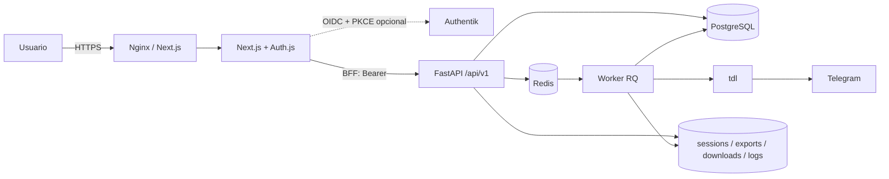

# TDL Console

[English](README.md) | **Español**

Consola web en español para descargar media de Telegram con `tdl`. Next.js presenta la
interfaz y actúa como BFF; FastAPI expone `/api/v1` y concentra la lógica; Redis/RQ ejecuta
los trabajos. PostgreSQL conserva jobs, archivos, plantillas, usuarios, sesiones y ajustes;
la sesión de Telegram, los exports, los logs y las descargas viven en el sistema de archivos.

La migración desde la UI Jinja/HTMX está implementada: frontend Next.js 16, API FastAPI,
autenticación local con usuario y contraseña y Authentik opcional, worker RQ y dos
despliegues independientes (nativo en LXC y Docker Compose). El login local y el flujo
opcional de Authentik están verificados en el entorno Docker local. Quedan pendientes de
validación real la instalación en un LXC, el túnel público y las descargas contra Telegram
real.

## Arquitectura



| Componente | Responsabilidad | No hace |
|---|---|---|
| Next.js | Pantallas, formularios, tema, polling, sesión y BFF | Ejecutar comandos ni leer archivos del servidor |
| FastAPI | API, validación, auth, persistencia y control de procesos | Renderizar HTML de la aplicación |
| Worker RQ | Export por rangos, filtrado, descargas por lotes y borrado | Servir HTTP |
| Redis | Cola de trabajos y tokens de ejecución | Guardar el estado de negocio |
| PostgreSQL 16 | Jobs, archivos, plantillas, usuarios, sesiones, auditoría y ajustes | Guardar archivos pesados |
| Sistema de archivos | Sesión de Telegram, exports, filtros, lotes, logs y descargas | Sustituir la base de datos |
| `tdl` | Acceso a Telegram y transferencia de archivos | Ser llamado desde el navegador |
| Authentik | Inicio de sesión único y política de acceso opcionales | Almacenar datos de la aplicación |
| Nginx (Docker) | TLS, rate limit y proxy same-origin | Lógica de negocio |

## Funciones

- Login local con usuario y contraseña, sin registro público; el instalador crea el primer
  administrador y solo los administradores gestionan las demás cuentas. Authentik es
  opcional (`AUTHENTIK_ENABLED`).
- Estado del sistema: sesión de Telegram, binario `tdl`, Redis, worker, almacenamiento y
  versión instalada.
- Chats con caché, búsqueda, tipo, orden, perfil, jobs y limpieza de descargas.
- Nueva descarga con chat, texto, hashtag, fechas, tipo de archivo, plantillas y subcarpeta.
- Export por rangos reanudable, filtrado y descarga por lotes con registro por archivo.
- Progreso honesto: barra indeterminada hasta conocer el total; ETA y velocidad solo cuando
  hay datos fiables.
- Cancelar, reintentar pendientes, reintentar solo fallidos y eliminar con `wipe`.
- Galería y lista de archivos, vista previa segura y descarga.
- Eventos y logs por job, búsqueda global, resumen y registros.
- Configuración editable: carpeta de descargas, timeouts y tamaños de lote. Si cambia la
  carpeta, los archivos se trasladan con verificación SHA-256 y actualización transaccional
  de rutas.
- Tema claro/oscuro, navegación responsive, foco visible y estados de carga, vacío, error y
  reconexión.

## Seguridad

Sin sesión, `/` redirige a `/login` en el mismo dominio de TDL. El login muestra
el botón «Continuar con Authentik»; el proveedor solo se abre al pulsarlo. `AUTH_URL`
es la URL pública de TDL, mientras `AUTHENTIK_ISSUER` identifica al proveedor.

- **Identidad:** Authentik emite JWT RS256 con PKCE. FastAPI valida firma, issuer, audiencia,
  expiración y, si está configurado, el grupo `tdl-admin`.
- **Sesión web:** Auth.js guarda la sesión en una cookie HttpOnly cifrada. Los tokens de
  access/refresh permanecen dentro de esa cookie: JavaScript no puede leerlos y nunca se
  guardan en `localStorage`.
- **BFF:** el navegador solo habla con Next.js. El BFF lee la sesión e inyecta el Bearer hacia
  FastAPI; la API no se publica directamente en Docker.
- **CSRF:** las escrituras exigen `X-Requested-With` y validan origen/referer. La creación de
  jobs acepta y conserva `Idempotency-Key`.
- **Archivos:** HTML, SVG y XML se sirven como `attachment`, con `CSP: sandbox` y
  `X-Content-Type-Options: nosniff`. Solo imagen, vídeo, audio y PDF se muestran inline.
- **Acciones destructivas:** borrar job, limpiar descargas, borrar plantilla y reset exigen
  confirmación validada en el servidor, no solo un diálogo del navegador.
- **Permisos:** `umask 0077`; base de datos, caché, logs y sesión en `600`; directorios en `700`.
- **Red:** TLS en Nginx (Docker) o en el túnel (nativo); rate limit de Nginx para `/api/` y
  `/api/auth/` en Docker; sin CORS en producción y Redis solo en loopback o red interna.
- **Secretos:** solo en variables de entorno del servidor. Nada sensible en `NEXT_PUBLIC_*`.

## Estructura del repositorio

```text
/
├── backend/app/            FastAPI, API v1, servicios, worker y modelos
├── backend/tests/          Pruebas de backend
├── frontend/app/           Rutas App Router, login y BFF
├── frontend/components/    UI de dominio y componentes comunes
├── frontend/lib/           Cliente API, tipos y utilidades
├── deploy/docker/          Compose de producción y pruebas, Dockerfiles
├── deploy/authentik/       Blueprint y bootstrap OIDC
├── deploy/nginx/           Plantillas de Nginx
├── deploy/systemd/         Unidades heredadas del despliegue nativo anterior
├── scripts/                Pruebas, configuración, datos y `tdl` simulado
├── install-tld.sh          Instalador maestro para LXC
├── docker-compose.yml      Envoltorio del Compose de producción
└── DESIGN.md               Guía visual y de producto
```

El paquete Python sigue llamándose `app` y el directorio de trabajo es `backend/`, por lo que
la ruta `app.worker.run_download_job` se conserva.

## Instalación nativa en LXC

Pensada para un LXC existente con systemd, Debian 13 (o Ubuntu 24.04/26.04) y arquitectura
x86_64 o arm64. Usa Node y `tdl` oficiales con SHA-256, Python con venv y Next.js standalone.
El instalador **no crea el LXC ni configura Cloudflare Tunnel**; tampoco instala Docker.

```bash
curl -fsSL https://raw.githubusercontent.com/overhang1275/tdl-web-next/refs/heads/main/install-tld.sh | sudo bash
```

El comando abre el asistente en la terminal disponible, incluso al ejecutarse por pipe.
El instalador crea automáticamente la configuración básica, las claves JWT y la contraseña
inicial del administrador. No necesitas copiar ni editar `.env`. Sin terminal, genera
igualmente el archivo y usa los valores proporcionados por entorno. `--yes` acepta los
valores por defecto. Una instalación ya activa cancela por defecto sin una acción explícita.
Desde una copia local puedes usar `sudo bash install-tld.sh --source-dir "$PWD"`.

El instalador permite instalar, actualizar, reparar, reconfigurar o cancelar. De forma
interactiva, Enter acepta los valores mostrados. Por defecto usa `/opt/tld-web`, escucha en
`127.0.0.1:8080`, crea el usuario de servicio `tld-web` sin login y ofrece Redis local
opcional. La API usa un puerto loopback separado (`8000`); los puertos ocupados se rechazan.

El login usa cuentas locales por defecto. El instalador crea el primer administrador y
guarda una contraseña de un solo uso en un archivo solo accesible por root; la app exige
cambiarla al entrar. No hay registro público y solo los administradores gestionan las demás
cuentas.

Authentik es opcional. Para activarlo, define `AUTHENTIK_ENABLED=true` y configura un
proveedor OIDC confidencial con PKCE, firma RS256, scopes
`openid profile email offline_access tdl-groups` y grupo `tdl-admin`. El scope `tdl-groups`
debe emitir el claim `groups`. El callback es
`AUTH_URL/api/auth/callback/authentik`; para el acceso local por defecto:
`http://localhost:8080/api/auth/callback/authentik`. No mezcles `localhost` y `127.0.0.1` en
el mismo flujo: la cookie pertenece al host que inicia el login.

`PUBLIC_URL` es una referencia opcional, vacía por defecto, y no modifica `AUTH_URL`. Para
publicar por `https://tld.opencore.dpdns.org`, configura el túnel hacia
`http://127.0.0.1:8080`, usa esa URL HTTPS como `AUTH_URL` y, si activas Authentik, registra
su callback allí.

Layout de la instalación:

```text
/opt/tld-web/tools/                Binarios versionados
/opt/tld-web/releases/<versión>/   Backend, venv y frontend standalone
/opt/tld-web/current               Enlace a la versión activa
/opt/tld-web/data/                 Sesión, exports, descargas, logs y claves JWT
/opt/tld-web/logs/                 Logs
/opt/tld-web/tmp/                  Temporales
/opt/tld-web/backups/              Respaldos de recuperación, solo root
```

Los defaults sin secretos se guardan en `/etc/tld-web/install.conf` y el entorno sensible en
`/etc/tld-web/tld-web.env`, accesible también mediante `/opt/tld-web/.env`. Se genera con
permisos restringidos y se conserva en los reintentos. La plantilla `.env.native.example`
queda como referencia opcional. La contraseña inicial del administrador está solo para root
en `/etc/tld-web/admin-password` (o la ruta de `ADMIN_PASSWORD_FILE`). Las instalaciones
anteriores conservan su archivo en `/etc/telegram-downloader`, usuario, rutas, unidades y
Nginx existente.

Servicios: `tld-web-api`, `tld-web-worker` y `tld-web`. Mantenimiento desde una copia local:

```bash
sudo bash install-tld.sh --action update --source-dir "$PWD"
sudo bash install-tld.sh --action repair
sudo bash install-tld.sh --dry-run
sudo journalctl -u tld-web-api -u tld-web-worker -u tld-web -f
```

Sin `--source-dir`, `auto` busca un bundle GitHub Release para la arquitectura y, si no
existe, construye desde Git. Puedes indicar `--ref latest`, tag o commit, y
`--method source|release|auto`. El contrato del bundle es
`tld-web-linux-x64.tar.gz` o `tld-web-linux-arm64.tar.gz` más `SHA256SUMS`; incluye
`backend/requirements.txt`, scripts de configuración/backup y el frontend standalone. Un
checksum inválido no se omite. Los repositorios privados requieren credenciales de Git y,
para consultar Releases, `GH_TOKEN` en el entorno, sin persistirlo.

La versión se construye antes del corte. La activación exige que no haya jobs, borrados ni
traslados pendientes, respalda PostgreSQL, entorno, defaults, unidades, sesión, exports y
logs, y conserva las descargas en su sitio. Un fallo recupera el enlace, la configuración,
las unidades y los servicios anteriores; el esquema y los datos de PostgreSQL no se
revierten automáticamente. Los respaldos **no incluyen los archivos descargados**: mantén
también tu respaldo externo de datos. `repair` y `configure` reutilizan la versión instalada
sin descargar ni compilar. En modo no interactivo, una instalación existente cancela si no se
indica `--action`; `--yes` acepta defaults y usa el administrador local configurado; OIDC es
opcional.

### Túnel en otra máquina de la LAN

Si `cloudflared` está fuera del LXC, ejecuta el maestro actualizado dentro del LXC:

```bash
sudo AUTH_URL=https://tld.opencore.dpdns.org bash install-tld.sh --action repair --lan --yes
```

No recompila la aplicación. El frontend escucha en IPv4, puerto 8080, con una
unidad nftables persistente que permite loopback y `192.168.100.0/24`, bloqueando
el resto únicamente en ese puerto. La API mantiene `127.0.0.1:8000`. La web exige
la unidad de firewall para arrancar; si el LXC no permite nftables, el cambio se
detiene antes de exponerla. Las demás reglas de firewall se conservan.

Para el LXC `192.168.100.254`, configura el destino del túnel como
`http://192.168.100.254:8080` (HTTP). La máquina de `cloudflared` debe pertenecer a
la subred permitida. Esta restricción protege el acceso directo al origen; los usuarios que
accedan por el túnel público entran con una cuenta local o con Authentik si está activado.

## Producción con Docker Compose

Esta vía incluye PostgreSQL, Redis, API, worker, Next.js y Nginx, además de Authentik
opcional. Solo Nginx publica 80/443 y es independiente del instalador nativo del LXC.

Requisitos: Docker Engine con Compose v2, dominio con `app.DOMAIN` y, para activar Authentik,
`auth.DOMAIN`, con certificados para esos nombres en `TLS_DIR`.

```bash
python3 scripts/configure-env.py --deployment docker --output .env --domain example.test
docker compose --env-file .env -f deploy/docker/compose.yml config --quiet
```

Revisa `.env`, prepara `DATA_DIR` y `DOWNLOADS_DIR` con el UID/GID configurado
(`APP_UID`/`APP_GID`, por defecto `10001`) y coloca los certificados en `TLS_DIR`. Conserva
las rutas absolutas originales al migrar datos existentes. `DATABASE_DIR` debe ser el
directorio de `DATABASE_URL`; sesión, exports, logs y base tienen montajes propios aunque
estén fuera de `DATA_DIR`. Después:

```bash
docker compose --env-file .env -f deploy/docker/compose.yml up -d --build --wait
```

El servicio `bootstrap` crea el primer administrador a partir de `ADMIN_PASSWORD_FILE`; la
app exige cambiar esa contraseña al entrar. Authentik es opcional: ejecuta
`bash deploy/authentik/bootstrap.sh` y define `AUTHENTIK_ENABLED=true` para activarlo.

El blueprint crea el cliente OIDC y el grupo `tdl-admin`; el bootstrap añade `akadmin` al
grupo. La contraseña inicial de Authentik está en `AUTHENTIK_BOOTSTRAP_PASSWORD` del `.env`.
No publiques ese archivo.

Antes de actualizar, drena la cola, respalda PostgreSQL y los volúmenes, haz `pg_dump` de
Authentik si está activo y conserva las imágenes anteriores para el rollback. El archivo raíz
`docker-compose.yml` incluye el mismo Compose.

## Uso

1. Entra por `/login` con una cuenta local, o con Authentik si está activado.
2. Conecta Telegram en Configuración mediante el login por código.
3. Crea una descarga eligiendo chat, filtros y, si quieres, una plantilla.
4. Sigue el progreso en el detalle; puedes cancelar, reintentar pendientes o fallidos y
   eliminar el job con `wipe`.
5. Revisa los archivos en la galería o lista del job y los eventos en Registros.

En Configuración puedes editar la carpeta de descargas y los límites de comando, lotes de
descarga/exportación y espera sin progreso. Se guardan en PostgreSQL y prevalecen sobre los
valores iniciales del entorno. Guarda con la cola vacía. Cambiar la carpeta exige confirmar
el traslado: el worker copia y verifica SHA-256, actualiza las rutas de los archivos y
después vacía el origen. Si falla, muestra el error y permite reintentar; las descargas
quedan bloqueadas hasta resolverlo. El destino debe estar vacío, tener espacio para una copia
completa y ser escribible.

En Docker utiliza una subcarpeta de `DATA_DIR`. Para otro volumen, móntalo con la misma ruta
en API y worker y declara su raíz en `DOWNLOADS_ALLOWED_ROOTS` (separadas por dos puntos). La
web no crea montajes del host. En LXC usa una carpeta dedicada escribible por el usuario del
servicio. No modifiques los archivos manualmente durante un traslado.

## API

Base: `/api/v1`. OpenAPI en `/api/docs` cuando `ENABLE_DOCS` está activo (desactivado por
defecto en producción). Los errores usan `{"error": {"code", "message", "detail"}}` y las
listas paginadas usan `{"items", "page", "per_page", "total", "page_count"}`.

| Grupo | Rutas principales |
|---|---|
| Salud y estado | `GET /health`, `GET /status`, `GET /auth/me` |
| Telegram | `GET /telegram/login`, `POST /telegram/login/start`, `/input`, `/cancel` |
| Chats | `GET /chats`, `GET /chats/{chat_id}`, `DELETE /chats/{chat_id}/downloads` |
| Plantillas | `GET/POST /templates`, `PUT/DELETE /templates/{id}` |
| Jobs | `GET/POST /jobs`, `GET /jobs/{id}`, `POST /jobs/{id}/cancel`, `/retry` |
| Archivos y logs | `GET /jobs/{id}/files`, `/files/{file_id}/content`, `/logs`, `/events` |
| Consultas | `GET /search`, `GET /dashboard`, `GET /settings` |
| Configuración | `PUT /settings`, `POST /settings/retry` |
| Administración | `POST /admin/reset` |

El login, callback, sesión y logout viven en Next.js/Auth.js (`/api/auth/*`). FastAPI emite
access tokens RS256 de vida corta y refresh tokens rotatorios; Auth.js los guarda en su
cookie HttpOnly cifrada y el BFF adjunta el access token. El flujo de Authentik es opcional.

## Datos y persistencia

| Dato | Dónde |
|---|---|
| Jobs, archivos, plantillas, ajustes, usuarios, sesiones y auditoría | PostgreSQL 16 (migraciones Alembic) |
| Cola y tokens de ejecución | Redis (`REDIS_URL`; en Docker, RQ usa una base separada) |
| Sesión de Telegram | `sessions/` |
| Export completo y snapshots por job | `exports/<chat>/` |
| Filtros y lotes intermedios | `exports/<chat>/filtered-job-<id>.json`, `batch-job-<id>.json` |
| Descargas | `downloads/<chat>/<subcarpeta>/job-<id>/<message_id>/<archivo>` |
| Logs | `logs/job-<id>.log`, `logs/deleted-jobs.log` |
| Caché de chats | `chats.json` |

El esquema PostgreSQL se gestiona con migraciones Alembic. No hay importador de SQLite: una
instalación limpia empieza con la base vacía y los archivos SQLite existentes no se borran.

## Pruebas

El stack de pruebas es aislado: PostgreSQL y Redis separados, OIDC/JWKS de prueba con
RS256/PKCE y un ejecutable `tdl` falso. No contacta Telegram ni monta datos de producción. Al
salir, los scripts eliminan exclusivamente los contenedores y volúmenes de pruebas.

```bash
bash scripts/test.sh
```

En Windows:

```powershell
./scripts/test.ps1
```

Los runners ejecutan Ruff, pytest, ESLint, TypeScript, Vitest y Playwright. La integración
recorre login → API → cola → export → filtro → descarga → borrado persistido.

Comprobación visual local después del build:

```powershell
$env:PLAYWRIGHT_PRODUCTION='1'
./scripts/playwright.ps1 test
```

La última verificación registrada (2026-10-26) dejó Ruff, 89 pytest, ESLint, TypeScript,
build, 18 Vitest y 10 Playwright en verde.

## Límites conocidos

- La instalación en un LXC real, el túnel de Cloudflare y una descarga real de Telegram aún
  no se han validado en su entorno definitivo.
- Los flags de `tdl` y el login por pty se ejercitaron con el ejecutable simulado en
  Linux/Docker, pero no se han validado contra `tdl` ni una cuenta real de Telegram.
- No hay pausa: `tdl` solo permite cancelar y reintentar. No se muestran porcentajes, ETA ni
  velocidad inventados.
- Un administrador, un proceso de API y un worker RQ con concurrencia 1. No hay multiusuario,
  roles ni cuotas.
- El polling sustituye a WebSocket/SSE por simplicidad.
- Solo se editan los cinco ajustes de ejecución; `.env` y la configuración sensible no se
  tocan desde la web.
- No se ha certificado conformidad WCAG completa ni se han probado Safari, Firefox y lectores
  de pantalla en todas las combinaciones.
- Los respaldos del instalador no incluyen las descargas; requiere un respaldo externo.
