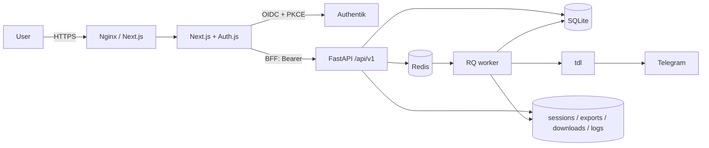

# TDL Console

**English** | [Español](README.es.md)

A Spanish-language web console for downloading Telegram media with `tdl`. Next.js renders
the interface and acts as a BFF; FastAPI exposes `/api/v1` and holds the application logic;
Redis/RQ runs the jobs. SQLite stores jobs, files, templates and settings, while the Telegram
session, exports, logs and downloads live on the filesystem.

The migration from the Jinja/HTMX UI is implemented: a Next.js 16 frontend, a FastAPI API,
Authentik authentication, an RQ worker and two independent deployment paths (native LXC and
Docker Compose). The real Authentik login has been verified in the local Docker environment.
A real LXC installation, the public tunnel and downloads against real Telegram are still
pending validation.

## Architecture



| Component | Responsibility | Does not |
|---|---|---|
| Next.js | Screens, forms, theme, polling, OIDC session and BFF | Run commands or read server files |
| FastAPI | API, validation, auth, persistence and process control | Render application HTML |
| RQ worker | Range exports, filtering, batched downloads and deletion | Serve HTTP |
| Redis | Job queue and execution tokens | Store business state |
| SQLite | Jobs, files, templates and runtime settings | Store large files |
| Filesystem | Telegram session, exports, filters, batches, logs and downloads | Replace the database |
| `tdl` | Telegram access and file transfer | Be called from the browser |
| Authentik | Single identity provider and access policy | Store application data |
| Nginx (Docker) | TLS, rate limiting and same-origin proxy | Business logic |

## Features

- Single sign-on through Authentik; the `tdl-admin` group grants access. There are no local
  passwords or in-app registration.
- System status: Telegram session, `tdl` binary, Redis, worker, storage and installed version.
- Chats with cache, search, type, order, profile, jobs and download cleanup.
- New download with chat, text, hashtag, dates, file type, templates and output subfolder.
- Resumable range exports, filtering and batched downloads with per-file tracking.
- Honest progress: an indeterminate bar until the total is known; ETA and speed only when
  reliable data exists.
- Cancel, retry pending files, retry failed files only, and delete with `wipe`.
- File gallery and list, safe preview and download.
- Per-job events and logs, global search, overview and activity log.
- Editable settings: downloads folder, timeouts and batch sizes. If the folder changes, files
  are moved with SHA-256 verification and a transactional route update.
- Light/dark theme, responsive navigation, visible focus and loading, empty, error and
  reconnection states.

## Security

- **Identity:** Authentik issues RS256 JWTs with PKCE. FastAPI validates signature, issuer,
  audience, expiry and, when configured, the `tdl-admin` group.
- **Web session:** Auth.js stores the session in an encrypted HttpOnly cookie. Access and
  refresh tokens stay inside that cookie: JavaScript cannot read them and they are never
  saved to `localStorage`.
- **BFF:** the browser only talks to Next.js. The BFF reads the session and injects the Bearer
  token toward FastAPI; the API is not published directly in Docker.
- **CSRF:** writes require `X-Requested-With` and validate origin/referer. Job creation accepts
  and preserves `Idempotency-Key`.
- **Files:** HTML, SVG and XML are served as `attachment`, with `CSP: sandbox` and
  `X-Content-Type-Options: nosniff`. Only images, video, audio and PDF are shown inline.
- **Destructive actions:** deleting a job, clearing downloads, deleting a template and reset
  require server-validated confirmation, not just a browser dialog.
- **Permissions:** `umask 0077`; database, cache, logs and session files use `600`; directories
  use `700`.
- **Network:** TLS in Nginx (Docker) or at the tunnel (native); Nginx rate limiting for
  `/api/` and `/api/auth/` in Docker; no CORS in production and Redis only on loopback or an
  internal network.
- **Secrets:** only in server environment variables. Nothing sensitive in `NEXT_PUBLIC_*`.

## Repository layout

```text
/
├── backend/app/            FastAPI, API v1, services, worker and models
├── backend/tests/          Backend tests
├── frontend/app/           App Router routes, login and BFF
├── frontend/components/    Domain UI and shared components
├── frontend/lib/           API client, types and utilities
├── deploy/docker/          Production and test Compose files, Dockerfiles
├── deploy/authentik/       OIDC blueprint and bootstrap
├── deploy/nginx/           Nginx templates
├── deploy/systemd/         Units inherited from the previous native deployment
├── scripts/                Tests, configuration, data and simulated `tdl`
├── install-tld.sh          Master installer for LXC
├── docker-compose.yml      Wrapper around the production Compose file
├── DESIGN.md               Visual and product guidelines
└── docs/                   Architecture, audits, designs and evidence (local)
```

The Python package is still named `app` and its working directory is `backend/`, so the
`app.worker.run_download_job` import path is preserved.

## Native installation on LXC

Designed for an existing LXC with systemd, Debian 13 (or Ubuntu 24.04/26.04) and x86_64 or
arm64. It uses official Node and `tdl` binaries with SHA-256 checks, Python in a virtualenv
and the Next.js standalone build. The installer **does not create the LXC, configure
Cloudflare Tunnel or install Docker**.

```bash
sudo bash install-tld.sh --source-dir "$PWD"
```

The wizard supports install, update, repair, reconfigure and cancel. Enter accepts the
displayed defaults. By default it uses `/opt/tld-web`, listens on `127.0.0.1:8080`, creates
the passwordless `tld-web` service account and offers optional local Redis. The API uses a
separate loopback port (`8000`); occupied ports are rejected.

Login requires an external Authentik instance. The wizard asks for the HTTPS issuer, client ID
and secret if they are missing. Configure a confidential OIDC provider with PKCE, RS256
signing, the `openid profile email offline_access tdl-groups` scopes and the `tdl-admin`
group. The `tdl-groups` scope must emit the `groups` claim. The callback is
`AUTH_URL/api/auth/callback/authentik`; for the default local access:
`http://localhost:8080/api/auth/callback/authentik`. Do not mix `localhost` and `127.0.0.1`
in the same flow: the cookie belongs to the host that starts the login.

`PUBLIC_URL` is an optional reference, empty by default, and does not change `AUTH_URL`. To
publish at `https://tld.opencore.dpdns.org`, point the tunnel at `http://127.0.0.1:8080`, use
that HTTPS URL as `AUTH_URL` and register its callback in Authentik.

Installation layout:

```text
/opt/tld-web/tools/                Versioned binaries
/opt/tld-web/releases/<version>/   Backend, virtualenv and standalone frontend
/opt/tld-web/current               Symlink to the active release
/opt/tld-web/data/                 SQLite, session and files
/opt/tld-web/logs/                 Logs
/opt/tld-web/tmp/                  Temporary files
/opt/tld-web/backups/              Recovery backups, root-only
```

Non-secret defaults are stored in `/etc/tld-web/install.conf` and the sensitive environment
in `/etc/tld-web/tld-web.env`. You can prepare the latter from `.env.native.example` before
running the installer. Previous installations keep their file in `/etc/telegram-downloader`,
along with their user, paths, units and existing Nginx configuration.

Services: `tld-web-api`, `tld-web-worker` and `tld-web`. Maintenance:

```bash
sudo bash install-tld.sh --action update --source-dir "$PWD"
sudo bash install-tld.sh --action repair
sudo bash install-tld.sh --dry-run
sudo journalctl -u tld-web-api -u tld-web-worker -u tld-web -f
```

Without `--source-dir`, `auto` looks for an architecture-specific GitHub Release bundle and,
if none exists, builds from Git. You can pass `--ref latest`, a tag or a commit, and
`--method source|release|auto`. The bundle contract is `tld-web-linux-x64.tar.gz` or
`tld-web-linux-arm64.tar.gz` plus `SHA256SUMS`; it contains `backend/requirements.txt`,
configuration/backup scripts and the standalone frontend. An invalid checksum is never
skipped. Private repositories require Git credentials and, to query Releases, `GH_TOKEN` in
the environment without persisting it.

The release is built before cutover. Activation requires no pending jobs, deletions or
transfers; it backs up SQLite, environment, defaults, units, session, exports and logs, and
leaves downloads in place. A failure restores the previous symlink, configuration, units,
database and services. Backups **do not include downloaded files**: keep your own external
data backup. `repair` and `configure` reuse the installed release without downloading or
building. In non-interactive mode, an existing installation cancels unless `--action` is
provided; `--yes` accepts defaults and requires OIDC credentials to be configured already.

## Production with Docker Compose

This path includes PostgreSQL, Authentik, Redis, the API, the worker, Next.js and Nginx. Only
Nginx publishes ports 80/443, and it is independent of the native LXC installer.

Requirements: Docker Engine with Compose v2, a domain with `app.DOMAIN` and `auth.DOMAIN`,
and certificates for both names in `TLS_DIR`.

```bash
python3 scripts/configure-env.py --deployment docker --output .env --domain example.test
docker compose --env-file .env -f deploy/docker/compose.yml config --quiet
```

Review `.env`, prepare `DATA_DIR` and `DOWNLOADS_DIR` with the configured UID/GID
(`APP_UID`/`APP_GID`, default `10001`) and place the certificates in `TLS_DIR`. Preserve the
original absolute paths when migrating existing data. `DATABASE_DIR` must be the directory of
`DATABASE_URL`; the session, exports, logs and database each have their own mounts even when
they live outside `DATA_DIR`. Then:

```bash
docker compose --env-file .env -f deploy/docker/compose.yml up -d --build --wait
bash deploy/authentik/bootstrap.sh
```

The blueprint creates the OIDC client and the `tdl-admin` group; the bootstrap adds `akadmin`
to the group. The initial password is in `AUTHENTIK_BOOTSTRAP_PASSWORD` in `.env`. Do not
publish that file.

Before updating, drain the queue, back up SQLite, run `pg_dump` for Authentik and back up the
volumes; keep the previous images for rollback. The root `docker-compose.yml` includes the
same Compose file.

## Usage

1. Sign in at `/login` through Authentik.
2. Connect Telegram in Settings using the code-based login.
3. Create a download by choosing a chat, filters and, optionally, a template.
4. Follow progress on the detail page; you can cancel, retry pending or failed files, and
   delete the job with `wipe`.
5. Browse the job's files in the gallery or list, and review events in Activity log.

In Settings you can edit the downloads folder and the limits for commands, download/export
batches and idle time. They are stored in SQLite and take precedence over the initial
environment values. Save with an empty queue. Changing the folder requires confirming the
transfer: the worker copies and verifies with SHA-256, updates file paths and then empties the
source. If it fails, it shows the error and allows a retry; downloads remain blocked until it
is resolved. The destination must be empty, have room for a full copy and be writable.

In Docker, use a subdirectory of `DATA_DIR`. For another volume, mount it at the same path in
the API and worker and declare its root in `DOWNLOADS_ALLOWED_ROOTS` (colon-separated). The web
app does not create host mounts. On LXC, use a dedicated folder writable by the service user.
Do not modify files manually during a transfer.

## API

Base: `/api/v1`. OpenAPI is available at `/api/docs` when `ENABLE_DOCS` is enabled (disabled
by default in production). Errors use `{"error": {"code", "message", "detail"}}` and paginated
lists use `{"items", "page", "per_page", "total", "page_count"}`.

| Group | Main routes |
|---|---|
| Health and status | `GET /health`, `GET /status`, `GET /auth/me` |
| Telegram | `GET /telegram/login`, `POST /telegram/login/start`, `/input`, `/cancel` |
| Chats | `GET /chats`, `GET /chats/{chat_id}`, `DELETE /chats/{chat_id}/downloads` |
| Templates | `GET/POST /templates`, `PUT/DELETE /templates/{id}` |
| Jobs | `GET/POST /jobs`, `GET /jobs/{id}`, `POST /jobs/{id}/cancel`, `/retry` |
| Files and logs | `GET /jobs/{id}/files`, `/files/{file_id}/content`, `/logs`, `/events` |
| Queries | `GET /search`, `GET /dashboard`, `GET /settings` |
| Settings | `PUT /settings`, `POST /settings/retry` |
| Administration | `POST /admin/reset` |

Login, callback, session and logout live in Next.js/Auth.js (`/api/auth/*`). FastAPI does not
issue tokens: it validates the Authentik Bearer token injected by the BFF.

## Data and persistence

| Data | Location |
|---|---|
| Jobs, files, templates and settings | SQLite `telegram_downloader.sqlite3` |
| Queue and execution tokens | Redis (`REDIS_URL`; in Docker, RQ uses its own database) |
| Telegram session | `sessions/` |
| Full export and per-job snapshots | `exports/<chat>/` |
| Filter and batch intermediates | `exports/<chat>/filtered-job-<id>.json`, `batch-job-<id>.json` |
| Downloads | `downloads/<chat>/<subfolder>/job-<id>/<message_id>/<file>` |
| Logs | `logs/job-<id>.log`, `logs/deleted-jobs.log` |
| Chat cache | `chats.json` |

SQLite migrations are additive (`dedupe_key`, persisted deletion and the `runtime_settings`
table for settings and transfers). Real data is never converted or deleted without a backup.

## Tests

The test stack is isolated: separate SQLite and Redis instances, a test OIDC/JWKS provider
with RS256/PKCE and a fake `tdl` executable. It does not contact Telegram or mount production
data. On exit, the scripts remove only the test containers and volumes.

```bash
bash scripts/test.sh
```

On Windows:

```powershell
./scripts/test.ps1
```

The runners execute Ruff, pytest, ESLint, TypeScript, Vitest and Playwright. The integration
flow covers login → API → queue → export → filter → download → persisted deletion.

Local visual check after a build:

```powershell
$env:PLAYWRIGHT_PRODUCTION='1'
./scripts/playwright.ps1 test
```

The last recorded verification (2026-10-26) left Ruff, 89 pytest tests, ESLint, TypeScript,
the build, 18 Vitest tests and 10 Playwright tests green. Screenshots and reports are kept in
`docs/design-audit/`.

## Documentation

| Document | Contents |
|---|---|
| [`DESIGN.md`](DESIGN.md) | Visual identity, tokens, components, accessibility and design criteria |
| [`docs/architecture/current-state.md`](docs/architecture/current-state.md) | Implemented state and analysis of the previous app |
| [`docs/architecture/target-state.md`](docs/architecture/target-state.md) | Reference architecture for the migration |
| [`docs/architecture/migration-map.md`](docs/architecture/migration-map.md) | Feature-by-feature traceability and what is kept, adapted or replaced |
| [`docs/audit/2026-10-26-current-app.md`](docs/audit/2026-10-26-current-app.md) | Security and technical-debt audit of the previous app |
| [`docs/design-audit/latest.md`](docs/design-audit/latest.md) | Latest UI/UX audit with evidence and screenshots |
| [`docs/authentik-local.md`](docs/authentik-local.md) | Local Authentik setup and operation |
| [`docs/material-3-expressive-mobile-plan.md`](docs/material-3-expressive-mobile-plan.md) | Mobile visual evolution plan |
| [`docs/superpowers/specs/`](docs/superpowers/specs/) | Migration, editable settings, installer and resumable-download designs |
| [`docs/superpowers/plans/`](docs/superpowers/plans/) | Implementation plans |
| [`docs/architecture/graphify/`](docs/architecture/graphify/) | Initial and final graphs, with reports |

The documents themselves are in Spanish. `docs/` and `graphify-out/` remain local and are
excluded from Git; the links work in this working copy. Audit screenshots are also local.

## Known limitations

- A real LXC installation, the Cloudflare tunnel and a real Telegram download have not yet
  been validated in their final environment.
- The `tdl` flags and pty login were exercised with the simulated executable on Linux/Docker,
  but they have not been validated against `tdl` or a real Telegram account.
- There is no pause: `tdl` only supports cancel and retry. Percentages, ETA and speed are
  never invented.
- One administrator, one API process and one RQ worker with concurrency 1. There is no
  multi-user support, roles or quotas.
- Polling replaces WebSocket/SSE for simplicity.
- Only the five runtime settings are editable; `.env` and sensitive configuration cannot be
  changed from the web app.
- Full WCAG conformance has not been certified, and Safari, Firefox and screen readers have
  not been tested in every combination.
- Installer backups do not include downloads; an external backup is required.
