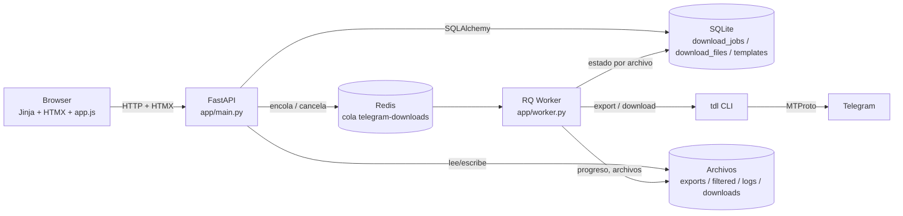
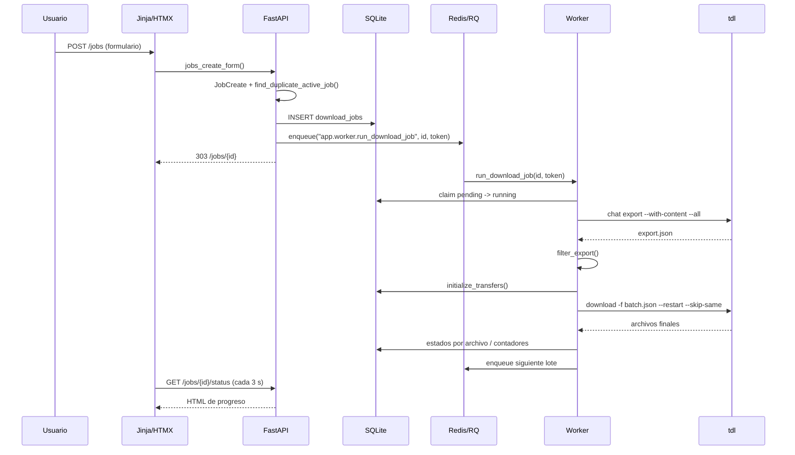

# Estado actual de tdl-web

Fecha: 2026-10-26
Commit analizado: `34f74c6e84a55606214902ba04be1df2378d4123`
Rama: `migration/nextjs-fastapi`
Copia: `C:\Users\init\Desktop\tdl-web-next`
Repositorio original (upstream): `https://github.com/overhang1275/tdl-web.git`

## 1. Resumen

tdl-web es una aplicación FastAPI que sirve una UI Jinja/HTMX y ejecuta `tdl` en un worker RQ
separado. El estado del trabajo vive en SQLite; Redis/RQ transporta los trabajos; el sistema de
archivos guarda exports, filtros, lotes, metadata, logs y descargas. La UI se renderiza en el
servidor y usa HTMX para polling de estado, eventos, logs, chats y login.

La app funciona para un administrador y un worker. Su punto fuerte es la lógica de descargas
reanudables por archivo y por rangos de exportación. Su punto débil es el monolito `app/main.py`
y la capa de seguridad web (ver auditoría).

## 2. Metadatos de Graphify

- Versión: `graphifyy 0.9.95` (Python 3.15, venv `.venv-graphify`).
- Comando base: pipeline `/graphify .` sobre la copia independiente, con extracción AST y
  extracción semántica de plantillas/documentación.
- Alcance: 57 archivos (`32` código, `25` documentos); 23.153 palabras.
- Exclusiones: `.git`, `.venv*`, `graphify-out/`, `data/`, `.env*`, `node_modules`, builds,
  cachés, SQLite, sesiones de Telegram, descargas, exports y logs. El `.gitignore` de la copia
  cubre esos patrones; Graphify no marcó archivos sensibles (`skipped_sensitive: []`).
- Artefactos:
  - `graphify-out/graph.json` (527 nodos, 1.580 relaciones, 15 comunidades).
  - `graphify-out/GRAPH_REPORT.md`.
  - `graphify-out/graph.html`.
  - Snapshot inicial en `docs/architecture/graphify/initial/`.
- Extracción: 88% EXTRACTED, 12% INFERRED, 0% AMBIGUOUS.
- Limitaciones:
  - 133 aristas de imports apuntan a módulos externos (`json`, `pathlib`, `sqlalchemy`, etc.)
    que no son nodos del repositorio; el build las descarta y el health check las reporta.
  - 89 aristas colapsadas al pasar de multigrafo a `DiGraph` (misma pareja con `calls`,
    `references`, `uses`).
  - 1 self-loop real: `mark_terminal()` se llama a sí mismo.
  - El corpus es pequeño; el propio informe avisa de que el grafo es una ayuda, no una
    sustitución de la lectura.
  - El enlace `enqueue_job` → `app.worker.run_download_job` es un string RQ: no aparece como
    arista AST. Se verificó leyendo `app/services/jobs.py:106-111` y `app/worker.py`.
- El HTML de Graphify actualizó automáticamente la skill global; se restauró desde `.bak` y se
  dejó `GRAPHIFY_NO_AUTO_REFRESH=1` para las siguientes ejecuciones.

## 3. Arquitectura actual



Relaciones comprobadas en código:

- La UI se sirve desde `app/templates/*` con `TemplateResponse`; las acciones son formularios
  POST y atributos `hx-get`/`hx-post` (extraído por Graphify: 30 relaciones UI → endpoint).
- `app/main.py` es el nodo central (140 conexiones). Contiene rutas, auth, estado, paginación,
  reset, descargas y arranque de servicios.
- `DownloadJob` es el modelo central (56 conexiones); `JobStatus` (42) y `TdlService` (35)
  concentran el resto.
- `app/worker.py` ejecuta `app.worker.run_download_job`; encola continuaciones por lote con
  `enqueue_job` y conserva el progreso en `download_files`.
- `app/services/tdl.py` construye argumentos separados (sin `shell=True`) y controla timeout,
  cancelación e inactividad.
- `app/services/transfers.py` verifica archivos, reconcilia estados y reutiliza archivos
  completos del mismo destino.

## 4. Módulos y responsabilidades

| Módulo | Responsabilidad | Reutilizable | Evidencia |
|---|---|---|---|
| `app/main.py` | Rutas HTML, auth, estado, paginación, descargas, reset | Adaptar | 1.140 líneas; 140 conexiones |
| `app/config.py` | Settings por entorno y `.env` | Conservar | Settings, load_env_file |
| `app/database.py` | Engine, sesión, `create_all`, migraciones aditivas | Conservar | `init_db`, `migrate_sqlite` |
| `app/models.py` | `DownloadJob`, `DownloadFile`, `DownloadTemplate` | Conservar | Enums y columnas |
| `app/schemas.py` | `JobCreate` y validadores | Adaptar/ampliar | Pydantic |
| `app/services/tdl.py` | Comandos `tdl`, timeout, cancelación, progreso | Conservar | `TdlService` |
| `app/services/filtering.py` | Filtros texto/hashtag/fecha/tipo, contenedores JSON | Conservar | `filter_export`, `message_matches` |
| `app/services/transfers.py` | Registro por archivo, verificación, reconciliación | Conservar | `initialize_transfers`, `reconcile_files` |
| `app/services/jobs.py` | Crear, encolar, cancelar, reintentar, listar, borrar | Adaptar | `create_job`, `retry_job`, `wipe_delete_job` |
| `app/worker.py` | Export por rangos, filtro, lotes, descarga, terminal | Conservar | `run_download_job`, `download_batch` |
| `app/services/paths.py` | Sanitizar subcarpetas y bloquear traversal | Conservar | `safe_child`, `chat_path_key` |
| `app/services/files.py` | Listar archivos, tamaños, tipos, rutas de job | Conservar | `list_downloaded_files`, `job_download_root` |
| `app/services/logs.py` | Log por job, eventos, cola de 50 KB | Conservar | `append_job_log`, `job_events` |
| `app/services/chat_cache.py` | Caché JSON de chats con lock | Conservar | `read_chats_cache`, `refresh_chats_cache` |
| `app/services/search.py` | Búsqueda global de chats/jobs/archivos | Adaptar | Recorre filesystem |
| `app/services/interactive_login.py` | Login pty de tdl | Adaptar | Solo Linux |
| `app/services/errors.py` | Traducción de errores técnicos | Conservar | `friendly_error` |
| `app/templates/*` | UI Jinja/HTMX | Sustituir | 21 plantillas |
| `app/static/js/app.js` | Polling de chats/notificaciones, toasts | Sustituir | 382 líneas |
| `scripts/install.sh` / `update.sh` | Instalación, backup, systemd | Adaptar | LXC |
| `deploy/*` | Nginx y systemd | Adaptar | Un solo servicio web + worker |

## 5. Endpoints actuales

| Método | Ruta | Plantilla/servicio | Notas |
|---|---|---|---|
| GET | `/health` | — | Sin auth |
| GET | `/` | redirect | A `/dashboard` |
| GET | `/dashboard` | `dashboard.html` | Llama a `tdl` para sesión |
| GET | `/search` | `search.html` | Búsqueda global |
| GET | `/notifications` | `notifications.html` | Actividad y servicios |
| GET | `/setup` | `setup.html` | Estado y login |
| POST | `/setup/reset` | `setup.html` | Confirmación `REINICIAR` |
| POST | `/setup/services/start` | `setup.html` | Arranca Redis/worker |
| POST | `/setup/login/start` | `partials/login_console.html` | pty |
| POST | `/setup/login/input` | `partials/login_output.html` | Entrada |
| GET | `/setup/login/console` | partial | Estado |
| GET | `/setup/login/output` | partial | Salida |
| POST | `/setup/login/cancel` | partial | Cancela |
| GET | `/chats` | `chats.html` | Carga por JS |
| GET | `/chats/list` | `partials/chats_table.html` | Búsqueda/filtros/paginación |
| GET | `/chats/{chat_id}` | `chat_profile.html` | Perfil |
| POST | `/chats/{chat_id}/clean-downloads` | redirect | Borra descargas |
| GET | `/jobs` | `jobs.html` | Plantillas + historial |
| POST | `/jobs` | `jobs.html` / redirect | Crea job |
| GET | `/jobs/{id}` | `job_detail.html` | Detalle |
| GET | `/jobs/{id}/status` | partial | Polling |
| POST | `/jobs/{id}/cancel` | redirect | Cancela |
| POST | `/jobs/{id}/retry` | redirect | Reintenta |
| POST | `/jobs/{id}/delete` | redirect | `wipe` en background |
| GET | `/jobs/{id}/logs` | partial | Tail |
| GET | `/jobs/{id}/events` | partial | Eventos |
| GET | `/downloads/{job_id}` | `downloads.html` | Galería |
| GET | `/downloads/{job_id}/file` | `FileResponse` | Inline/attachment |
| GET | `/downloads/{job_id}/preview` | `download_preview.html` | iframe |
| GET | `/api/jobs/notifications` | JSON | Toasts |
| POST | `/templates` | redirect | Crea plantilla |
| POST | `/templates/{id}/delete` | redirect | Borra |

## 6. Flujo UI → endpoint → tdl

### Comprobado (extraído por Graphify o lectura directa)



Puntos verificados:

- La UI no llama a `tdl` directamente; todo pasa por FastAPI y RQ.
- La relación `enqueue_job` → `run_download_job` es dinámica (string). Es una **inferencia
  verificada**, no una arista AST.
- `cancel_job` marca `cancel_requested`; el worker lo consulta en cada iteración de `_run`.
- `retry_job` conserva el mismo job y resetea solo lo pendiente/no completado.
- `wipe_delete_job` comprueba que la ruta esté dentro de `downloads/` antes de ejecutar `wipe`.

### Inferencias pendientes de validar en LXC

- Que `tdl` 0.20.x siga aceptando `--type id --input desde,hasta`, `--with-content`, `--all`,
  `--restart`, `--skip-same` y la plantilla `{{ .MessageID }}/{{ filenamify .FileName }}`.
  La app los usa, pero no se ejecutó `tdl` real en esta sesión.
- Que el login pty funcione igual en el LXC Debian/Ubuntu elegido.
- Que `wipe` esté instalado y permita `-rfiq` en el sistema de archivos del LXC.

## 7. Persistencia y estado

| Dato | Dónde | Notas |
|---|---|---|
| Jobs, archivos, plantillas | SQLite `telegram_downloader.sqlite3` | SQLAlchemy; migraciones aditivas |
| Cola y token de ejecución | Redis `telegram-downloads` | RQ; token por intento |
| Export completo | `exports/<chat>/export.json` | Publicación atómica |
| Snapshot por job | `exports/<chat>/export-job-<id>.json` | Conserva selección al reintentar |
| Fragmentos de export | `exports/<chat>/export-job-<id>/<desde>-<hasta>.json` | Cursor persistido |
| Filtro | `exports/<chat>/filtered-job-<id>.json` | Salida de `filter_export` |
| Metadata | `filtered-job-<id>.metadata.json` | ID del chat para tdl |
| Lote | `batch-job-<id>.json` | Mensajes del lote actual |
| Descargas | `downloads/<chat>/<subcarpeta>/job-<id>/<message_id>/<archivo>` | `.tmp` temporales |
| Logs | `logs/job-<id>.log`, `deleted-jobs.log` | Texto; tail 50 KB |
| Caché de chats | `chats.json` | `updated_at`, `total`, `chats` |
| Sesión Telegram | `sessions/tdl-data` | Bolt storage de tdl |

## 8. Validación de filtros y rutas

| Regla | Dónde | Comprobación |
|---|---|---|
| `chat_id` numérico o `@username` | `JobCreate.validate_chat_id` | Pydantic |
| Hashtag normalizado con `#` | `JobCreate.normalize_hashtag` | Pydantic |
| Subcarpeta segura | `sanitize_subfolder` | Regex `[A-Za-z0-9][A-Za-z0-9._-]*`; rechaza `.`/`..` |
| Rango de fechas | `validate_date_range` | `date_from <= date_to` |
| Path traversal | `safe_child` | `resolve()` + comprobación de padre |
| Clave de chat en disco | `chat_path_key` | Reemplaza caracteres inseguros |
| Archivo de descarga | `downloaded_file_path` | `safe_child` + `is_file()` |
| Borrado de job | `wipe_delete_job` | Ruta dentro de `downloads/` |
| URL de archivo | `download_file` / `preview_file` | `path` validado con `safe_child` |

## 9. Preguntas del grafo y respuestas

### ¿Qué conecta la UI actual con los endpoints?

Plantillas Jinja con `action`, `hx-get`, `hx-post` y enlaces; `app.js` con `data-chats-url`,
`fetch('/api/jobs/notifications')` y polling de chats. Graphify extrajo 30 relaciones UI →
endpoint y 26 relaciones handler → plantilla. La tabla de endpoints de la sección 5 es la
lista completa.

### ¿Qué endpoints llegan a la ejecución de tdl?

- `/jobs` (crear) → `create_job` → `enqueue_job` → RQ → `run_download_job` → `export_step` /
  `download_batch` → `TdlService.export_chat` / `download_from_file`.
- `/jobs/{id}/retry` → `retry_job` → `enqueue_job` → RQ → `run_download_job`.
- `/chats/list` y `/chats` → `refresh_chats_cache` → `TdlService.list_chats`.
- `/dashboard`, `/setup`, `/notifications` → `TdlService.is_logged_in`.
- `/setup/login/*` → `InteractiveLoginService` → `tdl login --type code` (pty).
- `/jobs/{id}/cancel` → `cancel_job` → RQ cancel / `cancel_requested`; el worker termina el
  proceso `tdl`.

La relación RQ es **inferida y verificada**; no es una arista AST por el string.

### ¿Dónde se validan filtros y rutas?

Ver tabla de la sección 8. Las validaciones críticas están en `schemas.py`, `paths.py`,
`files.py` y `jobs.wipe_delete_job`.

### ¿Cómo se almacena el estado?

Ver tabla de la sección 7. Lo importante: el estado de negocio está en SQLite; lo efímero de la
cola en Redis; lo pesado en el sistema de archivos. La UI no guarda estado propio salvo
`localStorage` para no repetir toasts (`tdl-web-job-statuses`).

### ¿Qué depende de las plantillas actuales?

Toda la capa de presentación: `base.html` (navegación, búsqueda, toasts), `dashboard.html`,
`jobs.html`, `job_detail.html` y sus partials, `chats.html`, `downloads.html`, `setup.html`,
`notifications.html`, `search.html`, `chat_profile.html`, `download_preview.html` y `404.html`.
También `app.js` (chats, polling, toasts, copiar ruta) y `app.css` (1.870 líneas de estilos).

### ¿Qué módulos pueden conservarse?

Se conservan sin reescritura: `services/tdl.py`, `services/filtering.py`, `services/transfers.py`,
`services/paths.py`, `services/files.py`, `services/logs.py`, `services/chat_cache.py`,
`services/errors.py`, `models.py`, `database.py`, `config.py` y la mayor parte de `worker.py`.
Se adaptan: `services/jobs.py`, `services/search.py`, `services/interactive_login.py`,
`schemas.py`, `scripts/*` y `deploy/*`.
Se sustituyen: `main.py` (rutas y UI), `templates/*`, `static/js/app.js`, `static/css/app.css`.

### ¿Qué cambiaría al separar frontend y backend?

- Desaparecen `TemplateResponse`, Jinja y HTMX; las rutas devuelven JSON.
- Aparecen esquemas de respuesta, paginación, errores consistentes y OpenAPI.
- La autenticación deja de ser una redirección/partial y pasa a ser API + Nginx.
- El polling de HTMX se sustituye por TanStack Query.
- La validación de formularios se duplica en cliente solo para UX; FastAPI sigue siendo autoritativo.
- Los archivos se sirven por ID de `download_file` (o path validado), no por plantilla.
- El frontend necesita estados de carga/error/reconexión y no puede leer rutas del servidor.

### ¿Qué componentes concentran más dependencias?

`app/main.py` (140), `DownloadJob` (56), `app/services/jobs.py` (54), `run_download_job` (33),
`TdlService` (35), `safe_child` (26), `retry_job` (21), `download_batch` (20). El grafo sugiere
que `main.py` es el principal candidato a división y que `TdlService`/`download_files` son el
núcleo que no debe reescribirse.

## 10. Código reutilizable

- **Alta:** `TdlService`, `filter_export`, `initialize_transfers`, `reconcile_files`,
  `verified_file`, `safe_child`, `download_batch`, `export_step`, `mark_terminal`,
  `sync_pending_jobs_with_queue`.
- **Media:** `create_job`, `enqueue_job`, `cancel_job`, `retry_job`, `wipe_delete_job`,
  `chat_cache`, `logs`, `files`.
- **Baja:** `main.py` (rutas), `templates`, `static`, `search.py` (recorrido de disco),
  `interactive_login.py` (pty, adaptar).

## 11. Pruebas de la línea base

Se ejecutaron en Windows las pruebas compatibles:

```text
tests/test_filtering.py tests/test_paths.py tests/test_files.py tests/test_logs.py
tests/test_jobs.py tests/test_resume.py
37 passed, 1 failed, 176 warnings
```

El fallo es de plataforma: `test_status_partial_shows_retry_button_after_live_failure` importa
`app.main`, que importa `pty`/`termios` (no existen en Windows). No se ejecutaron
`test_app.py`, `test_scripts.py` ni `test_tdl.py` por `pty`, `bash` y ejecución de scripts.
En Linux se espera la suite completa; no se afirma que pase hasta ejecutarla en el LXC o en un
contenedor Linux.

## 12. Riesgos y deuda

El detalle está en `docs/audit/2026-10-26-current-app.md`. Los principales: XSS en toasts,
HTML/SVG inline, auth opcional, códigos de Telegram visibles, borrados sin confirmación de
servidor, permisos de archivos, CSRF, duplicados de jobs, eliminación con `wipe` perdida,
llamadas a `tdl` en cada página, búsqueda que recorre el disco y ETA/velocidad poco fiables.

## 13. Dudas abiertas

- Confirmar la versión exacta de `tdl` y sus flags en el LXC objetivo.
- Confirmar que el LXC permite pty para el login interactivo.
- Decidir TLS (Let's Encrypt o certificado interno) según la red.
- Confirmar que el administrador acepta Basic auth en lugar de una pantalla de login.
- Confirmar el tamaño típico de la biblioteca (para dimensionar búsqueda y caché).
