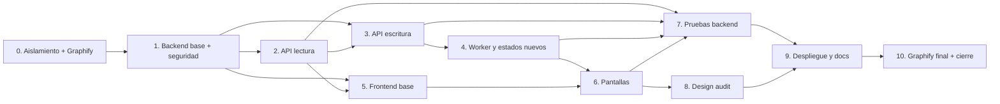

# Trazabilidad de la migración

Fecha: 2026-10-26
Estado: **diseño propuesto**, pendiente de aprobación y ejecución
Diseño: `docs/superpowers/specs/2026-10-26-nextjs-fastapi-migration-design.md`
Estado actual: `docs/architecture/current-state.md`
Grafo inicial: `docs/architecture/graphify/initial/graph.json`

## 1. Cómo leer esta tabla

- **Comprobado:** la relación existe en el código y se verificó leyendo el archivo indicado o
  con una arista EXTRACTED del grafo.
- **Inferido:** la relación es razonable pero no es una arista directa; se indica cómo se validó
  o qué falta probar.
- **Diseño propuesto:** el destino todavía no existe; es una decisión de esta migración.
- **Implementado:** se marcará al completar la etapa.

## 2. Tabla de trazabilidad

| # | Funcionalidad | Archivos/símbolos actuales | Relaciones comprobadas | Destino propuesto | Acción | Depende de | Pruebas | Riesgos |
|---|---|---|---|---|---|---|---|---|
| 1 | Auth web de administrador y JWT | `app/main.py:basic_auth_ok`, `security_middleware`; `.env.example` | Middleware protege todo salvo `/health`; `secrets.compare_digest` | `/login` + `POST /auth/login|refresh|logout`, cookies HttpOnly, JWT en API y middleware Next.js | Sustituir | 1, 5 | Login válido/inválido, cookies, refresh, logout, CSRF, middleware, 401→refresh | Token robado, CSRF, refresh replay, sesión sin revocar |
| 2 | Login Telegram interactivo | `services/interactive_login.py`; `/setup/login/*` | pty → `tdl login --type code`; partials de consola | `POST/GET /api/v1/telegram/login/*`; consola en `/settings` | Adaptar | 1, 5 | Inicio, input, cancelación, redacción de secretos | pty solo Linux; códigos visibles |
| 3 | Estado de servicios | `main.py:system_status`, `start_local_services`; `setup.html` | `tdl chat ls`, Redis ping, `Worker.all`, storage | `GET /api/v1/status`; `/settings` de solo lectura | Adaptar | 1 | tdl/Redis/worker caídos, caché TTL | Bloqueo por `tdl`; arranque desde web |
| 4 | Caché y lista de chats | `services/chat_cache.py`; `main.py:chats_list`; `chats_table.html` | `read_chats_cache` → `refresh_chats_cache` → `TdlService.list_chats` | `GET /api/v1/chats`; `/chats` | Conservar/Adaptar | 2 | caché vacío, refresh, error, filtros | Lock solo en un proceso |
| 5 | Perfil de chat | `main.py:chat_profile`; `chat_profile.html` | jobs por chat, export, tamaño de descargas | `GET /api/v1/chats/{id}`; `/chats/[id]` | Adaptar | 4 | chat con/sin jobs, export, archivos | Rutas y permisos |
| 6 | Limpiar descargas del chat | `main.py:chat_clean_downloads` | `safe_child` + `shutil.rmtree` | `DELETE /chats/{id}/downloads` con confirmación | Adaptar | 3 | confirmación, 404, no borrar exports | Borrado irreversible |
| 7 | Crear job | `main.py:jobs_create_form`; `schemas.JobCreate`; `jobs.create_job` | Formulario → `JobCreate` → `find_duplicate_active_job` → `create_job` → `enqueue_job` | `POST /api/v1/jobs`; `/downloads/new` | Adaptar | 3, 5, 6 | validación, duplicado, cola caída, idempotencia | Duplicados; jobs huérfanos |
| 8 | Plantillas | `main.py:templates_create/delete`; `models.DownloadTemplate` | Formulario → plantilla → prefill | `GET/POST/PUT/DELETE /api/v1/templates`; selector en Nueva descarga | Conservar/Adaptar | 7 | CRUD, validación, plantilla aplicada | Sin edición actual |
| 9 | Historial de jobs | `main.py:jobs_page`; `jobs.list_jobs`; `jobs_table.html` | `list_jobs` + `sync_pending_jobs_with_queue` | `GET /api/v1/jobs` con filtros/paginación; `/downloads` | Adaptar | 4 | filtros, paginación, estados | Crecimiento de la lista |
| 10 | Detalle y progreso | `main.py:job_detail/status`; `job_status.html`; `worker.py` | Job → contadores; polling HTMX cada 3 s | `GET /api/v1/jobs/{id}`; polling TanStack 2 s | Adaptar | 4, 8 | progreso antes/después de init, terminal | ETA/velocidad falsos |
| 11 | Cancelar job | `main.py:job_cancel`; `jobs.cancel_job` | `cancel_requested`; RQ cancel; `_run` comprueba cada 1 s | `POST /api/v1/jobs/{id}/cancel` | Conservar | 4 | pendiente, running, terminal | Proceso tdl que no muere |
| 12 | Reintentar/reanudar | `main.py:job_retry`; `jobs.retry_job`; `transfers.reset_pending_files` | Claim SQL + reset de pendientes + enqueue | `POST /api/v1/jobs/{id}/retry?mode=pending|failed` | Conservar/Adaptar | 4 | mismo job, archivos completos, fallidos | Duplicar trabajo; token viejo |
| 13 | Eliminar job con `wipe` | `main.py:job_delete`; `jobs.wipe_delete_job` | Ruta dentro de downloads → `wipe -rfiq` → borrar registro | `DELETE /api/v1/jobs/{id}` + job RQ persistido | Adaptar | 4 | wipe OK/fallo/ausente, reinicio de web | Tarea perdida; borrado físico |
| 14 | Export por rangos | `worker.export_step`; `TdlService.export_chat` | `latest` → cursor → fragmentos → snapshot atómico | Mismo worker; API solo lee estado | Conservar | 4 | rangos, reanudación, JSON inválido | Flags de tdl; cursor corrupto |
| 15 | Filtros | `services/filtering.py`; `schemas.JobCreate` | `message_matches` → `filter_export` | Mismos servicios; validación Pydantic ampliada | Conservar | 4, 7 | texto, hashtag, fecha, tipo, listas | Formatos raros de export |
| 16 | Registro por archivo | `services/transfers.py`; `models.DownloadFile` | `initialize_transfers` → `download_files`; `verified_file` | Misma tabla y servicios | Conservar | 4 | archivo faltante/truncado/tmp | Tamaño desconocido |
| 17 | Descarga por lotes | `worker.download_batch`; `TdlService.download_from_file` | Lote → tdl → reconciliación → siguiente RQ | Mismo worker; batch size configurable | Conservar | 4 | lotes, fallo aislado, timeout | Proceso colgado; rate limit |
| 18 | Logs y eventos | `services/logs.py`; `main.py:job_logs/events` | `append_job_log` → `read_job_log` → eventos | `GET /jobs/{id}/events|logs`; `/logs` | Conservar/Adaptar | 4 | tail 50 KB, eventos, job sin log | Datos sensibles en logs |
| 19 | Galería de archivos | `main.py:downloads_page`; `services/files.py`; `downloads.html` | `list_downloaded_files` → filtros/orden/paginación | `GET /jobs/{id}/files`; `/downloads/[id]` | Adaptar | 10 | tipos, orden, paginación | Recorrido de disco |
| 20 | Preview/descarga | `main.py:download_file/preview_file`; `download_preview.html` | `safe_child` → `FileResponse` | `GET /jobs/{id}/files/{file_id}/content` | Adaptar | 19 | traversal, MIME, attachment | XSS por HTML/SVG |
| 21 | Búsqueda global | `services/search.py`; `main.py:search_page` | chats cache + jobs + archivos | `GET /api/v1/search`; `/search` o barra global | Adaptar | 4, 9, 19 | vacío, chats, jobs, archivos | Lentitud O(jobs×files) |
| 22 | Notificaciones/toasts | `static/js/app.js`; `/api/jobs/notifications`; `notifications.html` | Polling 6 s + localStorage; toasts | Query de actividad + toasts en layout | Sustituir | 5, 9 | cambio de estado, terminal, error | XSS en `innerHTML` |
| 23 | Dashboard | `main.py:dashboard`, `dashboard_metrics`; `dashboard.html` | jobs + archivos + disco + chats | `GET /api/v1/dashboard`; `/` | Adaptar | 4, 9 | métricas, errores, disco | Escaneo de disco |
| 24 | Reset total | `main.py:setup_reset`; `reset_application_state` | Confirmación `REINICIAR`; cancela, vacía Redis, borra datos | `POST /api/v1/admin/reset` | Conservar/Adaptar | 3, 13 | confirmación, keep_session, Redis caído | Borrado masivo |
| 25 | Configuración/estado | `setup.html`; `config.Settings` | Env vars, rutas, límites | `GET /api/v1/settings`; `/settings` de solo lectura | Adaptar | 3 | rutas, límites, versión | Exponer secretos |
| 26 | Instalación/actualización | `scripts/install.sh`, `update.sh`; `deploy/*` | venv, systemd, Nginx, backup SQLite | `deploy/install.sh`, `update.sh`; 3 servicios | Adaptar | 25 | instalación limpia, update, rollback | Permisos, TLS, Node/Python |
| 27 | Pruebas | `tests/*` | 37 passed/1 bloqueada en Windows | `backend/tests/*`, `frontend` tests, Playwright | Adaptar/Ampliar | 1-26 | suite completa, lint, build, e2e | Cobertura de seguridad |

## 3. Dependencias entre etapas

Reglas:

- No se empieza una etapa si la anterior no tiene sus pruebas en verde o el bloqueo documentado.
- La etapa 5 puede avanzar en paralelo con 2-4 usando la API acordada.
- La etapa 8 solo empieza cuando hay una UI ejecutable.
- La etapa 9 no se considera terminada sin instalación limpia y rollback documentado.
- La etapa 10 conserva el grafo inicial y genera uno final sin sobrescribirlo.

## 4. Qué se conserva, adapta, sustituye o retira

### Conservar

`services/tdl.py`, `services/filtering.py`, `services/transfers.py`, `services/paths.py`,
`services/files.py`, `services/logs.py`, `services/chat_cache.py`, `services/errors.py`,
`models.py`, `database.py`, `config.py`, `worker.py` (con cambios mínimos), `rq_worker.py`,
`tests/test_filtering.py`, `tests/test_paths.py`, `tests/test_files.py`, `tests/test_logs.py`,
`tests/test_jobs.py`, `tests/test_resume.py`.

### Adaptar

`services/jobs.py` (idempotencia, borrado persistido, retry failed), `services/search.py`
(consulta SQLite), `services/interactive_login.py` (import diferido de pty, sin eco de secretos),
`schemas.py` (entrada/salida y paginación), `main.py` (dividir en routers), `scripts/*`,
`deploy/*`, `Dockerfile`/`docker-compose.yml` (opcionales y seguros).

### Sustituir

`app/templates/*`, `app/static/js/app.js`, `app/static/css/app.css`, las rutas HTML de
`app/main.py` y el polling HTMX. La funcionalidad se replica en Next.js; no se elimina del
inventario.

### Retirar

`scan_download_progress` (sin uso), `exclude_message_ids` y `message_ids_from_export` si no se
usan fuera de pruebas, `BackgroundTasks` para `wipe`, el arranque de Redis/worker desde la web
en producción y Jinja/HTMX del runtime.

## 5. Relaciones que Graphify no puede ver

- `enqueue_job` → `app.worker.run_download_job` por string RQ. **Inferida y verificada** en
  `app/services/jobs.py:106-111`.
- `run_download_job` → `enqueue_job` para la continuación del siguiente lote. **Extraída**.
- `tdl` → Telegram. **Fuera del corpus**; se asume por la documentación de tdl.
- `wipe` → sistema de archivos. **Fuera del corpus**; se valida con pruebas y con el binario.
- Nginx/systemd → FastAPI/Next.js. **Diseño propuesto**, no está en el grafo actual.

## 6. Pruebas por etapa

| Etapa | Pruebas mínimas |
|---|---|
| 1 | Health, auth obligatoria, CSRF, cabeceras, configuración inválida |
| 2 | Chats, jobs, archivos, búsqueda, dashboard, paginación, errores |
| 3 | Crear (incluido duplicado), cancelar, reintentar, borrar, plantillas, reset, login |
| 4 | Export por rangos, reanudación, reintento failed, wipe persistido, ETA null/fiable |
| 5 | API client, tema, navegación, estados de carga/error |
| 6 | Formularios, filtros, detalle, archivos, teclado, responsive |
| 7 | Suite backend, Vitest, Playwright, lint, tipos, build |
| 8 | Design auditor: 390x844, 1280x800, 1440x900, contraste, foco |
| 9 | Instalación limpia, update, backup, rollback, health |
| 10 | Grafo final, comparación con inicial, artefactos |

## 7. Riesgos de la trazabilidad

- Una función sin fila en esta tabla es una función que se puede perder. El inventario se
  revisará contra `README.md`, plantillas y endpoints antes de cerrar.
- Las etiquetas “comprobado” no se extienden a lo que no se ejecutó: `tdl`, Telegram, pty,
  `wipe` y el LXC siguen pendientes de validación real.
- El grafo inicial no contiene el estado futuro; las relaciones de destino son diseño, no
  hallazgos de Graphify.
