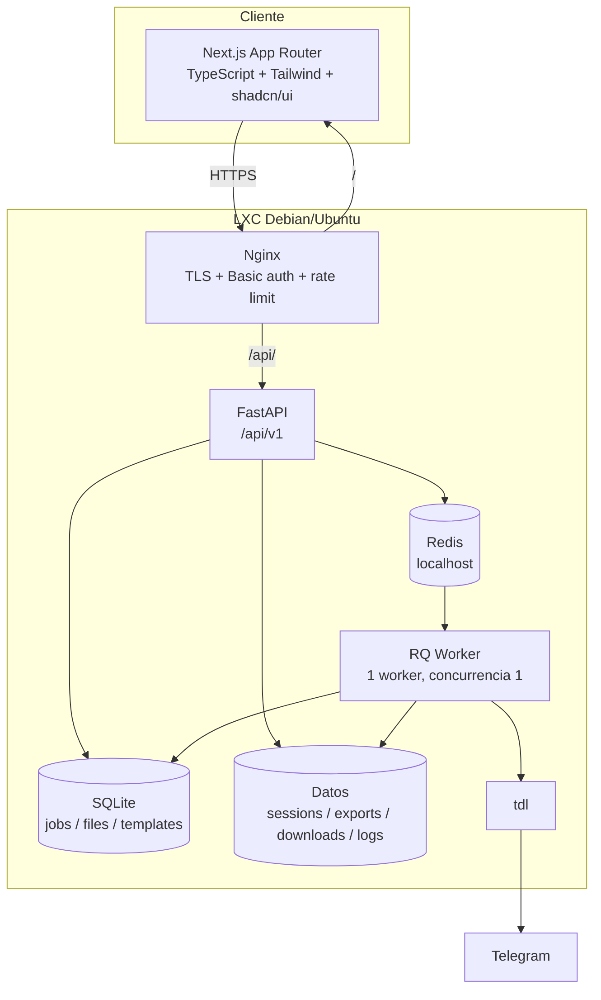
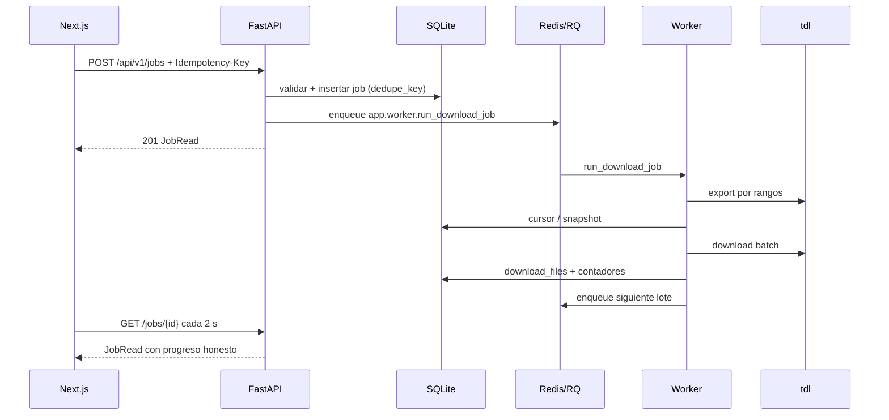
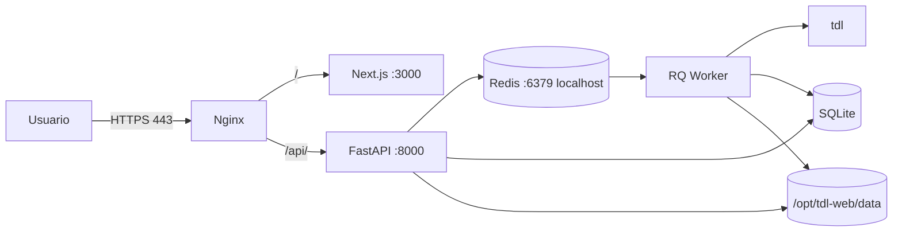

# Arquitectura objetivo

Fecha: 2026-10-26
Estado: **diseño propuesto**, no implementado todavía
Diseño de referencia: `docs/superpowers/specs/2026-10-26-nextjs-fastapi-migration-design.md`
Estado actual: `docs/architecture/current-state.md`

## 1. Principio

Mantener la lógica de descargas que ya funciona y cambiar la capa de presentación y el contrato.
FastAPI sigue siendo el único que ejecuta `tdl`, toca el sistema de archivos y persiste. Next.js
solo presenta y consume la API. Redis/RQ se conserva para no reescribir cancelación, reintentos,
reanudación y recuperación de huérfanos.

## 2. Diagrama



## 3. Componentes

| Componente | Responsabilidad | No hace |
|---|---|---|
| Next.js | Pantallas, formularios, polling, tema, accesibilidad | Ejecutar comandos, leer archivos del servidor, duplicar reglas de negocio |
| FastAPI | API, validación, auth, CSRF, procesos, persistencia | Renderizar HTML de la app |
| RQ Worker | Export, filtro, descarga por lotes, borrado con `wipe` | Servir HTTP |
| Redis | Cola y tokens de ejecución | Guardar el estado de negocio |
| SQLite | Jobs, archivos, plantillas, configuración derivada | Guardar archivos pesados |
| Sistema de archivos | Exports, filtros, lotes, logs, descargas, sesión | Sustituir la base de datos |
| tdl | Acceso a Telegram y transferencia | Ser llamado desde el navegador |
| Nginx | TLS, Basic auth, límites, proxy same-origin | Lógica de negocio |

## 4. Estructura de repositorio

```text
/
├── frontend/
│   ├── app/                    Rutas App Router
│   ├── components/             UI y dominio
│   ├── lib/                    api.ts, types.ts, query-keys.ts, utils
│   ├── public/
│   ├── package.json
│   ├── pnpm-lock.yaml          o package-lock.json
│   ├── next.config.ts
│   ├── tsconfig.json
│   └── eslint.config.mjs
├── backend/
│   ├── app/
│   │   ├── main.py
│   │   ├── config.py
│   │   ├── database.py
│   │   ├── models.py
│   │   ├── schemas.py
│   │   ├── security.py
│   │   ├── api/v1/
│   │   ├── services/
│   │   ├── worker.py
│   │   └── rq_worker.py
│   ├── tests/
│   ├── requirements.txt
│   └── pyproject.toml
├── deploy/
│   ├── nginx/tdl-web.conf
│   ├── systemd/tdl-web-api.service
│   ├── systemd/tdl-web-worker.service
│   ├── systemd/tdl-web-frontend.service
│   ├── install.sh
│   └── update.sh
├── docs/
│   ├── architecture/
│   ├── audit/
│   ├── design-audit/
│   └── superpowers/
├── scripts/playwright.ps1
├── .env.example
├── README.md
└── .gitignore
```

`backend/` es el directorio de trabajo del venv. El paquete sigue siendo `app`, por lo que
`app.worker.run_download_job` conserva su ruta de importación y los jobs RQ en vuelo pueden
terminar durante el corte.

## 5. API

Base: `/api/v1`. JSON, Pydantic, OpenAPI en `/api/docs` (protegido en producción).

- `GET /health`, `GET /status`.
- `POST /auth/login/start`, `/auth/login/input`, `/auth/login/cancel`; `GET /auth/login`.
- `GET /chats`, `GET /chats/{chat_id}`, `DELETE /chats/{chat_id}/downloads`.
- `GET/POST /templates`, `PUT/DELETE /templates/{id}`.
- `GET/POST /jobs`, `GET /jobs/{id}`, `POST /jobs/{id}/cancel`, `POST /jobs/{id}/retry`,
  `DELETE /jobs/{id}`.
- `GET /jobs/{id}/events`, `/logs`, `/files`, `/files/{file_id}/content`.
- `GET /search`, `GET /dashboard`, `GET /settings`.
- `POST /admin/reset`, `POST /services/start` (solo desarrollo).

Contratos:

- Error uniforme `{"error": {"code", "message", "detail"}}`.
- Paginación uniforme `{"items", "page", "per_page", "total", "page_count"}`.
- Fechas ISO 8601 con zona UTC.
- No se exponen rutas absolutas ni tokens de Telegram.
- `Idempotency-Key` opcional en `POST /jobs`.

## 6. Pantallas

| Ruta | Pantalla | Funciones |
|---|---|---|
| `/` | Resumen | Estado, métricas, activos, errores, nueva descarga |
| `/downloads` | Descargas | Historial, filtros, paginación, acciones |
| `/downloads/new` | Nueva descarga | Chat, filtros, plantilla, export, validación |
| `/downloads/[id]` | Detalle | Progreso, acciones, eventos, logs, archivos |
| `/chats` | Chats | Cache, búsqueda, tipo, orden |
| `/chats/[id]` | Perfil | Export, jobs, descargas, limpiar |
| `/logs` | Registros | Actividad y logs por job |
| `/settings` | Configuración | Estado, login, rutas/límites de solo lectura, reset |

Navegación: sidebar en escritorio, bottom nav en móvil. “Nueva descarga” es la acción primaria.
No se añaden landing pages ni pantallas de marketing.

## 7. Flujo de un job



## 8. Persistencia y migración

- Mismo esquema SQLite; columnas nuevas: `dedupe_key`, `deletion_requested`,
  `total_expected_bytes` (derivado) y `eta_seconds` (calculado en lectura/worker).
- Índice único parcial para jobs activos con la misma `dedupe_key`.
- Mismos directorios de datos y mismas rutas de archivos.
- Migraciones aditivas al arrancar; backup de SQLite antes de actualizar.
- Sin conversión de datos ni borrado de archivos reales.
- La UI antigua se retira del runtime; queda en el historial de Git y en este análisis.

## 9. Seguridad

- `WEB_PASSWORD` obligatoria en producción; Basic auth en Nginx + FastAPI.
- TLS; `ALLOW_INSECURE_HTTP` solo explícito para laboratorio.
- `X-Requested-With` + Origin/Referer para escrituras; sin CORS en producción.
- Rate limit en Nginx; bloqueo temporal.
- CSP con nonce; sin CDN sin SRI; sin `dangerouslySetInnerHTML`.
- Archivos peligrosos como `attachment`; `CSP: sandbox`; tipos seguros inline.
- `UMask=0077`; datos 600/700.
- Confirmaciones de servidor para acciones destructivas.
- Sin secretos en `NEXT_PUBLIC_*`.
- Redis en localhost.
- Un worker de API y uno de RQ.

## 10. Despliegue



Servicios systemd: `tdl-web-api`, `tdl-web-worker`, `tdl-web-frontend`; Redis del sistema.
Sin root; `ProtectSystem=strict`; `ReadWritePaths` solo datos. Nginx same-origin. Docker opcional
y fuera del camino principal.

## 11. Criterios de aceptación

- Paridad funcional verificable con pruebas y un `tdl` falso.
- Sin regresiones de reanudación ni de progreso.
- Auth obligatoria, CSRF, XSS y archivos peligrosos cubiertos por pruebas.
- UI a 390x844, 1280x800 y 1440x900; teclado, foco y contraste.
- `pytest`, `ruff`, `eslint`, `tsc --noEmit`, `next build` y Playwright ejecutados.
- `docs/design-audit/latest.md` con capturas antes/después.
- Grafo final actualizado y comparado con el inicial.
- Proyecto original intacto.

## 12. Etiquetas de estado

- **Comprobado:** todo lo descrito en `current-state.md` con referencia a código.
- **Inferido:** relación RQ string `enqueue_job` → `run_download_job`; compatibilidad de flags
  de `tdl` y pty en el LXC (pendiente de validar en Linux).
- **Diseño propuesto:** este documento, la API, las pantallas y el despliegue.
- **Implementado:** se irá marcando en `migration-map.md` al completar cada etapa.
