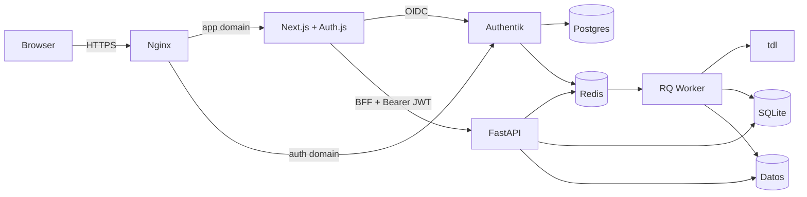

# Migración de tdl-web a Next.js + FastAPI

Fecha: 2026-10-26
Estado: diseño propuesto, pendiente de aprobación
Commit base: `34f74c6e84a55606214902ba04be1df2378d4123`
Repositorio de trabajo: `C:\Users\init\Desktop\tdl-web-next` (origin privado nuevo; upstream original)
Informe de la app actual: `docs/audit/2026-10-26-current-app.md`
Grafo inicial: `docs/architecture/graphify/initial/`

## 1. Intención

Crear una nueva versión de tdl-web con frontend Next.js y backend FastAPI, conservando la
integración real con `tdl` y todas las funciones que hoy usa el administrador. La app actual
funciona, pero mezcla UI y API en un monolito Jinja/HTMX, tiene fallos de seguridad concretos y
no ofrece una API tipada. La migración debe reducir riesgo, no reescribir la lógica de descargas.

## 2. Objetivos

- Conservar el comportamiento real: login de Telegram, chats, filtros, exportación, descargas
  por lotes, progreso, cancelación, reintento/reanudación, borrado, galería, búsqueda,
  plantillas y logs.
- Separar responsabilidades: FastAPI ejecuta `tdl`, gestiona procesos y persiste; Next.js solo
  presenta y consume la API.
- API `/api/v1` tipada, con OpenAPI, errores consistentes y health/readiness.
- Interfaz renovada, responsive, en español, con tema claro/oscuro y accesibilidad.
- Despliegue con Docker Compose en LXC Debian/Ubuntu, incluyendo Authentik, Postgres y Redis.
- Corregir los riesgos de seguridad del informe y añadir pruebas que los cubran.

## 3. No objetivos

- Multiusuario, roles, cuotas o aislamiento entre administradores más allá de Authentik.
- Pausar/reanudar de verdad: `tdl` no ofrece pausa; solo cancelar y reintentar.
- WebSocket/SSE: el polling cubre el caso y es más simple.
- Editar `.env` o configuración sensible desde la UI.
- Límites de velocidad o programación: no verificados en la versión de `tdl`.
- Sustituir Redis/RQ por una cola propia.
- Duplicar la lógica de negocio en Next.js (solo el proxy BFF de autenticación).

## 4. Anti-objetivos

- Duplicar la lógica de `tdl`, filtros o trabajos en Next.js.
- Mostrar porcentajes, ETA o velocidad inventados.
- Exponer secretos, rutas absolutas, tokens de Authentik o sesiones de Telegram al navegador.
- Eliminar funciones existentes sin documentarlo.
- Cambiar el formato de la base de datos o los archivos de datos sin migración y respaldo.
- Mantener un segundo sistema de login local además de Authentik.

## 5. Restricciones

- LXC Debian/Ubuntu con Docker Compose; Authentik como proveedor de identidad.
- Python 3.12+; Node 22 LTS; Redis; Postgres para Authentik; Nginx; `tdl`.
- SQLite existente y directorios de datos actuales.
- Un solo administrador y un solo worker de RQ.
- La UI y la API comparten origen público; Next.js hace de BFF para `/api/`.
- No se publican cambios ni se hace merge/pull request sin autorización.

## 6. Enfoques considerados

### A. FastAPI + Redis/RQ existente, Next.js como frontend (elegido)

Se conservan `app/services/*`, `app/worker.py`, `app/models.py`, SQLite y la cola RQ. Se sustituye
la capa Jinja/HTMX por una API FastAPI y un frontend Next.js. El worker sigue ejecutando
`app.worker.run_download_job` y mantiene la reanudación por archivo y por rangos de exportación.

- Ventaja: reutiliza la lógica más delicada y ya probada; menor riesgo de perder progreso.
- Coste: Redis sigue siendo dependencia; hay que portar rutas y pruebas.
- Riesgo: el desacoplamiento de la UI puede romper contratos si no se prueba.

### B. FastAPI con cola propia en SQLite, sin Redis

Se elimina Redis/RQ y se implementa una cola en SQLite con reclamación atómica, cancelación,
reintentos, continuación y recuperación de huérfanos.

- Ventaja: menos servicios.
- Coste: reescribir la parte más delicada; más riesgo de duplicar trabajos o perder progreso.
- Riesgo: alto. No se elige.

### C. Conservar Jinja/HTMX y envolver con Next.js

Se mantiene la UI actual y se añade Next.js como capa externa.

- Ventaja: menos cambios inmediatos.
- Coste: no cumple la migración de frontend; duplica responsabilidades.
- Riesgo: deuda y confusión. No se elige.

## 7. Arquitectura elegida

```text
/
├── frontend/                 Next.js App Router + TypeScript + Tailwind + shadcn/ui
├── backend/
│   ├── app/
│   │   ├── main.py           crea FastAPI, middlewares, routers
│   │   ├── config.py         settings existentes
│   │   ├── database.py       engine, sesión, migraciones
│   │   ├── models.py         DownloadJob, DownloadFile, DownloadTemplate
│   │   ├── schemas.py        entrada/salida Pydantic
│   │   ├── security.py       validación JWT Authentik, CSRF, cabeceras
│   │   ├── api/v1/           health, status, auth/me, chats, jobs, files, templates,
│   │   │                     search, dashboard, settings, admin
│   │   ├── services/         tdl, filtering, transfers, jobs, files, logs,
│   │   │                     chat_cache, search, errors, paths, login, status, auth
│   │   ├── worker.py         ejecución RQ (misma ruta de importación)
│   │   └── rq_worker.py      arranque del worker
│   ├── tests/
│   └── requirements.txt
├── deploy/
│   ├── docker/compose.yml
│   ├── docker/compose.test.yml
│   ├── docker/Dockerfile.api
│   ├── docker/Dockerfile.web
│   ├── nginx/tdl-web.conf
│   └── authentik/bootstrap.sh
├── docs/
│   ├── architecture/
│   ├── audit/
│   ├── design-audit/
│   └── superpowers/
├── scripts/playwright.ps1
├── .env.example
├── README.md
└── .gitignore
```

El paquete Python sigue llamándose `app` y el directorio de trabajo del backend es `backend/`.
Así, la ruta `app.worker.run_download_job` no cambia y los jobs RQ en vuelo siguen siendo
importables durante la transición.



## 8. Responsabilidades

### FastAPI

- Ejecutar `tdl` con argumentos separados, sin `shell=True`.
- Gestionar la sesión de Telegram y el login interactivo por pty (solo Linux).
- Crear, reclamar, cancelar, reintentar y eliminar trabajos.
- Leer/escribir SQLite, exports, filtered, metadata, logs y descargas.
- Validar filtros, rutas, tamaños, estados y confirmaciones.
- Servir archivos con cabeceras seguras.
- Validar el JWT de Authentik (JWKS, issuer, audience, expiración) y aplicar CSRF/errores.

### Next.js

- Presentar las pantallas y consumir `/api/v1` a través del BFF.
- Gestionar el login OIDC con Authentik y la sesión web con Auth.js.
- Inyectar el `Authorization: Bearer` en el proxy BFF; nunca exponerlo al navegador.
- Validar formularios en cliente para UX; la validación autoritativa es FastAPI.
- Gestionar tema, navegación, estados de carga/vacío/error/reconexión y accesibilidad.
- No ejecutar comandos, no leer archivos del servidor, no duplicar lógica de negocio.

### Authentik

- Ser el único proveedor de identidad y emitir los JWT.
- Aplicar la política de acceso (grupo `tdl-admin`) antes de emitir el token.
- Gestionar usuarios, MFA, sesiones y logout. La app no almacena contraseñas.

## 9. Modelo de trabajos

Se conserva el modelo actual:

1. `POST /api/v1/jobs` valida el payload, calcula una huella e inserta el job.
2. El job se encola en RQ (`telegram-downloads`) con `app.worker.run_download_job`.
3. El worker exporta por rangos de IDs, publica `export.json` atómicamente, filtra y registra
   cada archivo en `download_files`.
4. Descarga por lotes de `DOWNLOAD_BATCH_SIZE`; tras un fallo, reintenta por mensaje hasta 3 veces.
5. Cada lote se encola como un job RQ nuevo; un token impide que un worker viejo finalice otro intento.
6. Al terminar, el job queda `completed`, `failed` o `cancelled`.

Se conservan:
- `cancel_job`: marca `cancel_requested`; el worker comprueba cada segundo y termina el proceso.
- `retry_job`: continúa el mismo job desde los archivos pendientes; conserva los completados.
- `sync_pending_jobs_with_queue`: convierte jobs huérfanos en fallidos reanudables.
- `wipe_delete_job`: elimina la carpeta con `wipe` y solo entonces borra el registro.

Cambios:
- La creación usa una huella única (`dedupe_key`) y un índice único parcial para jobs activos.
  Dos peticiones simultáneas no crean dos jobs; la segunda recibe `409` con el job existente.
- La eliminación deja de usar `BackgroundTasks`. Se persiste `deletion_requested` y se encola
  `app.worker.delete_job`; si la web se reinicia, el worker o el reconciliador la retoman.
- `retry_job` acepta `mode=pending|failed`: `pending` conserva el comportamiento actual;
  `failed` reencola solo los archivos fallidos y deja los completados intactos.
- El progreso expone `total_expected_bytes` y `eta_seconds=null` cuando no hay datos fiables.

### Workers soportados

- **API:** un solo proceso Uvicorn (`--workers 1`). El login pty y el lock del caché de chats
  son estado en memoria; varios procesos los romperían.
- **RQ:** un solo worker con concurrencia 1. Evita dos procesos `tdl` compitiendo por la misma
  cuenta y disco. La cola puede crecer, pero no se ejecutan jobs en paralelo.
- Si en el futuro se necesita concurrencia, habrá que mover login/caché a estado compartido y
  añadir bloqueo por chat. No forma parte de esta migración.

## 10. Persistencia

Se conserva SQLite y el esquema actual:

- `download_jobs`: configuración, estado, stage, contadores, rutas de export/filtered/download,
  cursor de exportación, token RQ, error, timestamps, `deletion_requested`, `dedupe_key`.
- `download_files`: un registro por mensaje/archivo, estado, intentos, tamaño, error y ruta local.
- `download_templates`: plantillas de filtros.
- `chats.json`: caché de chats (título, id, username, tipo, topics).
- Archivos: `exports/<chat>/export.json`, `filtered-job-<id>.json`, `export-job-<id>.json`,
  fragmentos `export-job-<id>/<desde>-<hasta>.json`, `batch-job-<id>.json`, metadata.
- Descargas: `downloads/<chat>/<subcarpeta>/job-<id>/<message_id>/<archivo>`.
- Logs: `logs/job-<id>.log`, `logs/deleted-jobs.log`.

No hay conversión de datos. Las migraciones son aditivas (`ALTER TABLE`, índices) y se ejecutan
al arrancar. Antes de actualizar se hace copia de SQLite con WAL checkpoint.

## 11. API `/api/v1`

Todas las respuestas de error usan:

```json
{"error": {"code": "job_not_found", "message": "El job no existe.", "detail": null}}
```

Paginación:

```json
{"items": [], "page": 1, "per_page": 20, "total": 0, "page_count": 1}
```

Rutas:

| Método | Ruta | Función |
|---|---|---|
| GET | `/api/v1/health` | Liveness mínima, sin auth |
| GET | `/api/v1/status` | tdl, sesión, Redis, worker, almacenamiento, versión |
| GET | `/api/v1/auth/me` | Identidad del JWT de Authentik |
| POST | `/api/v1/telegram/login/start` | Inicia login pty de Telegram |
| POST | `/api/v1/telegram/login/input` | Envía teléfono/código/2FA |
| POST | `/api/v1/telegram/login/cancel` | Cancela login de Telegram |
| GET | `/api/v1/telegram/login` | Estado y salida redactada |
| GET | `/api/v1/chats` | Lista/cache, búsqueda, tipo, orden, paginación |
| GET | `/api/v1/chats/{chat_id}` | Perfil, export, jobs, archivos |
| DELETE | `/api/v1/chats/{chat_id}/downloads` | Limpia descargas con confirmación |
| GET | `/api/v1/templates` | Lista plantillas |
| POST | `/api/v1/templates` | Crea plantilla |
| PUT | `/api/v1/templates/{id}` | Edita plantilla |
| DELETE | `/api/v1/templates/{id}` | Borra plantilla con confirmación |
| GET | `/api/v1/jobs` | Historial con filtros y paginación |
| POST | `/api/v1/jobs` | Crea job; acepta `Idempotency-Key` |
| GET | `/api/v1/jobs/{id}` | Detalle y progreso |
| POST | `/api/v1/jobs/{id}/cancel` | Cancela |
| POST | `/api/v1/jobs/{id}/retry` | Reintenta `pending` o `failed` |
| DELETE | `/api/v1/jobs/{id}` | Solicita borrado con `wipe` |
| GET | `/api/v1/jobs/{id}/events` | Eventos recientes |
| GET | `/api/v1/jobs/{id}/logs` | Tail de log |
| GET | `/api/v1/jobs/{id}/files` | Archivos con paginación |
| GET | `/api/v1/jobs/{id}/files/{file_id}/content` | Descarga/preview segura |
| GET | `/api/v1/search` | Chats, jobs y archivos |
| GET | `/api/v1/dashboard` | Métricas y errores recientes |
| GET | `/api/v1/settings` | Configuración de solo lectura |
| POST | `/api/v1/admin/reset` | Reinicio total con `REINICIAR` |
| POST | `/api/v1/services/start` | Solo desarrollo; 404 en producción |

Esquemas principales: `JobCreate`, `JobRead`, `JobFileRead`, `TemplateCreate`, `TemplateRead`,
`ChatRead`, `StatusRead`, `DashboardRead`, `SearchRead`, `Page[T]`, `ApiError`.

El login, callback, logout y sesión web viven en Next.js/Auth.js (`/api/auth/*`). FastAPI no
emite tokens: solo valida el Bearer de Authentik que inyecta el BFF.

## 12. Autenticación y seguridad

- **Authentik como único IdP.** El login web lo gestiona Auth.js con el proveedor OIDC de
  Authentik (authorization code + PKCE). La app no almacena contraseñas ni emite tokens.
- **Sesión web.** Auth.js guarda la sesión en una cookie HttpOnly, Secure y SameSite=Lax,
  cifrada con `AUTH_SECRET`. El navegador nunca ve el access token de Authentik.
- **BFF.** El proxy `app/api/v1/[...path]/route.ts` lee la sesión con Auth.js, obtiene el
  access token de Authentik y lo inyecta como `Authorization: Bearer` hacia FastAPI. El
  navegador solo habla con Next.js; FastAPI no está publicado directamente.
- **Validación en FastAPI.** `PyJWT` valida firma RS256 con JWKS de Authentik, `iss`, `aud`,
  `exp` y `iat`; opcionalmente exige el grupo `tdl-admin` en `groups`. El JWKS se cachea.
- **Renovación.** Auth.js renueva el access token con el refresh token de Authentik antes de
  que caduque. Si el refresh falla, la sesión se invalida y se vuelve a `/login`.
- **Autorización.** Authentik aplica la política de acceso al application `tdl-console` para el
  grupo `tdl-admin`. FastAPI vuelve a comprobar el claim de grupo si está configurado.
- **CSRF.** Cookie de sesión SameSite + `X-Requested-With: tdl-web` + `Origin`/`Referer` propio
  en escrituras. El BFF valida el origen antes de reenviar. No hay CORS en producción.
- **TLS obligatorio** en Nginx. `ALLOW_INSECURE_HTTP=true` solo para un laboratorio explícito.
- **Rate limit:** `limit_req` de Nginx para `/api/` y `/api/auth/`; bloqueo temporal.
- **XSS:** Next.js escapa por defecto; prohibido `dangerouslySetInnerHTML` con datos de Telegram.
  Los toasts usan texto, no HTML.
- **Archivos:** `Content-Disposition: attachment` para HTML/SVG/XML; `CSP: sandbox` en respuestas
  de archivos; `X-Content-Type-Options: nosniff`; solo imágenes/video/audio/PDF inline.
- **Secretos:** `AUTH_SECRET`, `AUTHENTIK_CLIENT_SECRET` y `POSTGRES_PASSWORD` viven solo en
  variables de entorno del servidor, nunca en `NEXT_PUBLIC_*`.
- **Permisos:** `UMask=0077` en contenedores y `os.umask(0o077)` al arrancar; DB, caché, logs y
  sesión en 600; directorios en 700.
- **Login de Telegram:** no se registra la entrada del usuario; la salida de `tdl` se muestra con
  los valores sensibles redactados.
- **Confirmaciones:** borrado de job, limpieza de chat, borrado de plantilla y reset exigen un
  campo/token de confirmación validado en FastAPI; no basta `confirm()` del navegador.
- **Servicios:** `services/start` solo existe en desarrollo. En producción, Docker Compose
  gestiona Redis y worker.
- **Redis:** red interna de Docker, sin exposición; Authentik y RQ usan bases separadas.
- **Cabeceras:** CSP con nonce de Next.js, `frame-ancestors 'none'`, `Referrer-Policy: same-origin`,
  `Permissions-Policy` mínima, HSTS cuando hay TLS.

## 13. Progreso y reconexión

- Polling con TanStack Query: 2 s mientras el job está `pending/running`; 30 s si está terminal;
  se detiene al cerrar la pestaña.
- Antes de `transfer_initialized`, la UI muestra stage y barra indeterminada; no inventa porcentaje.
- Después, porcentaje = `total_downloaded_files / total_filtered_messages`, acotado a 100.
- Velocidad: solo se muestra si `download_speed_bps > 0` y el job está descargando; etiqueta
  “aproximado”.
- ETA: solo si `total_expected_bytes` es conocido, la velocidad es estable y quedan bytes; si no,
  `null` y “—”.
- Al recargar, la UI vuelve a pedir `/api/v1/jobs/{id}` y `/api/v1/status`; no inicia jobs.
- Si la API se cae, TanStack Query reintenta con backoff y muestra “Reconectando…”. El job sigue
  en el worker. Si el worker se cae, el reconciliador marca el job como fallido reanudable.
- Cerrar el navegador no cancela nada.

## 14. Interfaz

Pantallas:

1. **Login** (`/login`): pantalla de marca con un único botón “Continuar con Authentik”. Redirige
   al proveedor OIDC; no hay formulario de contraseña ni registro en la app.
2. **Resumen** (`/`): estado de sesión/servicios, métricas, jobs activos, últimos errores,
   botón “Nueva descarga”.
3. **Descargas** (`/downloads`): historial con filtros (estado, chat, texto), tabla en escritorio
   y tarjetas en móvil, paginación, acciones.
4. **Nueva descarga** (`/downloads/new`): selector de chat con búsqueda, filtros, plantillas,
   aviso de export existente, validación y confirmación.
5. **Detalle** (`/downloads/[id]`): progreso honesto, acciones (cancelar, reintentar, eliminar),
   eventos, logs con autocarga, archivos.
6. **Chats** (`/chats`, `/chats/[id]`): lista, perfil, export, jobs, limpiar descargas.
7. **Registros** (`/logs`): actividad reciente y acceso a logs por job.
8. **Configuración** (`/settings`): estado, rutas y límites de solo lectura, login Telegram,
   usuario/sesión, servicios (solo lectura en producción), zona de peligro con confirmación.

Navegación: sidebar en escritorio, bottom nav en móvil; “Nueva descarga” como acción primaria.
Menú de usuario con nombre, rol y cerrar sesión. Tema claro/oscuro con `next-themes`; tipografía
del sistema; tokens en `DESIGN.md`.
Estados: carga (skeleton), vacío, error, reconexión, sin permiso, job eliminando, sesión expirada.
Accesibilidad: foco visible, navegación por teclado, labels, `aria-live` para progreso/toasts,
contraste AA, `prefers-reduced-motion`.

## 15. Despliegue

- **SO:** Debian 13 o Ubuntu 24.04 con Docker Engine y Compose v2.
- **Stack:** `postgres` (Authentik), `redis` (Authentik db 0, RQ db 1), `authentik-server`,
  `authentik-worker`, `api`, `worker`, `web`, `nginx`. Solo Nginx publica 80/443.
- **Imágenes:** `ghcr.io/goauthentik/server:2026.8.5` (server y worker) y builds propios
  `docker/Dockerfile.api`, `docker/Dockerfile.web`.
- **tdl:** se instala en la imagen del worker/API desde el instalador oficial; se valida
  `tdl --version` en el build. `TDL_BINARY` configurable.
- **Authentik:** OIDC application `tdl-console`, grupo `tdl-admin`, redirect URI
  `${APP_URL}/api/auth/callback/authentik`; bootstrap con token y script idempotente.
- **Nginx:** TLS, rate limit, `app.${DOMAIN}` → `web:3000` (incluye `/api/` BFF) y
  `auth.${DOMAIN}` → `authentik-server:9000`; health directo a `api:8000/health`.
- **Datos:** volumen `app-data` para SQLite, sesión de Telegram, exports, descargas y logs;
  `postgres-data`, `authentik-media` y `authentik-certs` para Authentik.
- **Actualización:** backup SQLite + volúmenes, `docker compose pull`, migración, restart,
  health check; rollback con la versión anterior.
- **Tests:** `compose.test.yml` levanta Redis, un mock OIDC/JWKS y los contenedores de prueba;
  los tests de backend y frontend corren dentro de Docker. El smoke test opcional usa Authentik
  real en el stack de producción.
- **Sin systemd:** se retira como camino principal; el LXC solo ejecuta Docker.

## 16. Migración de datos y corte

1. Etiquetar el estado actual y respaldar SQLite (incluido WAL) y `chats.json`.
2. Detener web y worker antiguos; vaciar o drenar la cola RQ.
3. Desplegar backend nuevo con el mismo esquema; ejecutar migraciones aditivas.
4. Arrancar worker nuevo; verificar que `app.worker.run_download_job` se importa.
5. Arrancar API y frontend; verificar health, login, chats y un job de prueba sin Telegram real
   (fake `tdl`).
6. Si hay jobs en vuelo, dejarlos terminar antes del corte o marcarlos fallidos y reintentar.
7. Rollback: restaurar DB, arrancar servicios antiguos; los archivos descargados no se tocan.

No se convierten ni borran datos reales sin autorización.

## 17. Pruebas

- **Backend:** pytest con SQLite temporal, RQ falso y `TdlService` falso. Cubrir filtros, rutas,
  construcción de comandos, errores de tdl, ciclo de vida, duplicados, reanudación, export por
  rangos, cancelación, borrado, JWT de Authentik, CSRF, content-disposition, idempotencia y
  progreso honesto.
- **Frontend:** Vitest + Testing Library para formularios, estados y accesibilidad; Playwright para
  los flujos esenciales contra el stack Docker.
- **Verificación:** `ruff`, `pytest`, `eslint`, `tsc --noEmit`, `next build`, Playwright y
  `docker compose -f deploy/docker/compose.test.yml up --build`.
- Las pruebas no usan Telegram real ni descargan archivos reales. Los mocks se identifican.

## 18. Riesgos

| Riesgo | Mitigación |
|---|---|
| Pérdida de progreso al cambiar de worker | Misma ruta `app.worker.run_download_job`; drenar cola; pruebas de reanudación |
| Duplicar jobs por doble clic | `dedupe_key` + índice único parcial + `Idempotency-Key` |
| Borrado `wipe` perdido | Estado persistido + job RQ + reconciliación al arrancar |
| Login pty solo Linux | Guardar import de pty; probar en LXC; fallback de comando CLI |
| Redis expuesto | Bind localhost; opcional password; Nginx no lo publica |
| XSS por títulos/archivos | Next.js escapa; sin innerHTML; archivos peligrosos como attachment |
| Lentitud por `tdl chat ls` | Caché de estado con TTL; health separado |
| Búsqueda lenta | Consultar `DownloadFile`; límite y paginación |
| SQLite con dos procesos | Worker y API usan WAL; escrituras cortas; no hay dos workers |
| JWT de Authentik sin validar audience/issuer | Validación estricta con JWKS, issuer y audience |
| Token expuesto al navegador | BFF inyecta el Bearer; sesión Auth.js HttpOnly |
| Authentik caído | El login falla cerrado; health muestra el estado; no hay login local |
| Pruebas en Windows | Todo corre en Docker/Linux; pty con import diferido |

## 19. Decisiones del diseño

- Se conserva Redis/RQ (A).
- Authentik es el único IdP; Auth.js gestiona la sesión web y el BFF inyecta el Bearer.
- FastAPI valida el JWT de Authentik con JWKS, issuer y audience.
- Docker Compose es el camino de producción y de pruebas; systemd se retira.
- Polling, no SSE/WebSocket.
- Un worker de API y uno de RQ.
- SQLite existente, migraciones aditivas.
- Se elimina Jinja/HTMX del runtime; la UI antigua queda en el historial de Git.
- Se conserva `app.worker.run_download_job` como ruta de importación.
- Se añaden `dedupe_key`, `deletion_requested`, `deletion_error`, `deletion_rq_job_id` y el
  cálculo de `total_expected_bytes`/`eta_seconds`.
- La UI nueva no muestra rutas absolutas ni secretos.

## 20. Criterios de aceptación

- `GET /api/v1/health` responde 200; `GET /api/v1/status` informa tdl, Redis y worker.
- `docker compose -f deploy/docker/compose.yml up -d --build` levanta el stack completo.
- `/login` redirige a Authentik; un usuario del grupo `tdl-admin` entra y uno sin grupo no.
- FastAPI rechaza un Bearer ausente, expirado o con audience/issuer incorrectos.
- El navegador no recibe el access token de Authentik ni lo guarda en `localStorage`.
- Un POST sin `X-Requested-With` o con origen cruzado recibe 403.
- Un intento de crear dos jobs idénticos activos devuelve uno solo y 409 en el segundo.
- Un job de prueba con `tdl` falso recorre export → filtro → descarga → completed.
- Cancelar detiene el proceso; reintentar conserva archivos completados.
- Eliminar un job usa `wipe`; si falla, el registro y la carpeta se conservan y se puede reintentar.
- La UI funciona a 390x844, 1280x800 y 1440x900; sin scroll horizontal; foco visible; tema claro/oscuro.
- `pytest`, `ruff`, `eslint`, `tsc --noEmit`, `next build`, Playwright y los tests en Docker pasan
  o queda documentado el bloqueo.
- `/design-auditor` produce `docs/design-audit/latest.md` y capturas antes/después.
- El proyecto original no cambia de rama, remotos, commits ni archivos.

## 21. Decisiones de implementación

### 21.1 Authentik, Auth.js y BFF

- Authentik expone un application OIDC `tdl-console`; solo el grupo `tdl-admin` puede entrar.
- Auth.js (NextAuth v5) usa un provider OIDC genérico con issuer, client ID/secret y PKCE.
  La sesión se guarda en cookie HttpOnly cifrada con `AUTH_SECRET`.
- `app/api/auth/[...nextauth]/route.ts` expone login/callback/session/logout.
- `middleware.ts` de Auth.js protege las rutas privadas y redirige a `/login`; `/login` es pública.
- `app/api/v1/[...path]/route.ts` es el BFF: lee el token con `getToken`, valida origen,
  inyecta `Authorization: Bearer` y reenvía a `API_INTERNAL_URL`. No reenvía cookies ni el
  `Authorization` del cliente.
- FastAPI valida firma RS256, `iss`, `aud`, `exp` con JWKS de Authentik. Si `groups` está
  configurado, exige `tdl-admin`. El JWKS se cachea.
- `GET /api/v1/auth/me` devuelve la identidad validada (sub, email, name, groups).
- El refresh lo hace Auth.js con el refresh token de Authentik; si falla, invalida la sesión.
- Las escrituras exigen `X-Requested-With: tdl-web`; el BFF comprueba `Origin` contra el host.
- El navegador nunca ve el access token ni lo guarda en `localStorage`.

### 21.2 Datos en el frontend

- Las páginas usan componentes cliente para datos; el layout puede ser servidor.
- `apiFetch` usa rutas relativas `/api/v1` (BFF), `credentials: "same-origin"` y la cabecera
  `X-Requested-With`. No existe `NEXT_PUBLIC_API_URL` ni token en `localStorage`.
- En desarrollo, el BFF de Next.js reenvía a `http://127.0.0.1:8000`; en Docker a `http://api:8000`.
  No hay CORS porque el navegador solo habla con Next.js.
- TanStack Query reintenta una vez, refresca al volver a la pestaña y detiene el polling cuando
  el job es terminal.
- Un 401 del BFF redirige a `/login` (la sesión de Auth.js expiró). Un 403 se muestra como estado
  de error, no como pantalla en blanco.
- El layout autenticado incluye menú de usuario, cierre de sesión y nombre del workspace.

### 21.3 Corte y compatibilidad RQ

- `git mv app backend/app`, `git mv tests backend/tests`, `git mv requirements.txt backend/`.
- El directorio de trabajo de API y worker es `backend/`; el paquete sigue siendo `app`.
- Se conserva la cola `telegram-downloads` y la función `app.worker.run_download_job`.
- Antes del corte se drena la cola o se deja terminar el job en curso. Si no, se marca fallido y
  se reintenta con la nueva versión.
- `chats.json`, SQLite y los directorios de datos no cambian de sitio.
- El servicio web antiguo se detiene; se arrancan API, worker y frontend nuevos.

### 21.4 Archivos y tipos peligrosos

- Ruta principal: `GET /api/v1/jobs/{id}/files/{file_id}/content?download=true`.
- Compatibilidad: `GET /api/v1/jobs/{id}/files/content?path=...` para archivos antiguos sin fila
  en `download_files`; el path se valida con `safe_child`.
- `Content-Disposition: attachment` para `text/html`, `application/xhtml+xml`,
  `image/svg+xml`, `application/xml`, `text/xml` y desconocidos.
- `inline` solo para `image/*`, `video/*`, `audio/*` y `application/pdf`.
- Todas las respuestas de archivos llevan `X-Content-Type-Options: nosniff` y
  `Content-Security-Policy: sandbox`.
- La UI no usa iframes para HTML; el texto se muestra como texto.

### 21.5 Borrado con `wipe`

- `DELETE /api/v1/jobs/{id}` exige `{"confirm": true}`.
- Si el job está `pending/running`: se marca `cancel_requested`, se pone `deletion_requested=1`
  y se encola `app.worker.delete_job` con delay de 5 s.
- `delete_job` comprueba el estado; si sigue activo, vuelve a encolarse con delay. Cuando es
  terminal, ejecuta `wipe_delete_job`.
- Si `wipe` falla o no está instalado, guarda `deletion_error` y conserva el registro y la carpeta.
- Al arrancar el worker, `reconcile_deletions()` reencola los `deletion_requested` que no tengan
  un job de borrado activo.
- La UI muestra “Eliminando” mientras `deletion_requested=1` y el error si existe.

### 21.6 Idempotencia y duplicados

- `dedupe_key` es SHA-256 de la tupla canónica de filtros, chat, carpeta, export y modo.
- Índice único parcial `WHERE status IN ('pending','running')`.
- Migración: añadir columna, calcular claves de jobs activos, crear el índice. Si hay duplicados
  históricos, se conserva la clave del más antiguo y se dejan los demás en `NULL`.
- `POST /jobs` devuelve `409 duplicate_job` con `detail.job_id`.
- `Idempotency-Key` se incorpora a la huella si está presente; dos peticiones con la misma clave
  y payload devuelven el mismo job.

### 21.7 Progreso y ETA

- `JobRead` expone `progress_percent` (nullable), `total_expected_bytes` (nullable),
  `downloaded_bytes`, `speed_bps` y `eta_seconds` (nullable).
- Antes de `transfer_initialized`, `progress_percent` es `null`; la UI usa barra indeterminada.
- `total_expected_bytes` es la suma de `expected_size`; si algún archivo no tiene tamaño, es `null`.
- `speed_bps` usa una media exponencial; si es 0 o el job no está descargando, la UI muestra “—”.
- `eta_seconds` solo se calcula si `total_expected_bytes` no es `null` y `speed_bps > 0`.
- No se muestran porcentajes ni ETA inventados.

### 21.8 Reintento de fallidos

- `retry_job(db, job, mode="pending")` conserva el comportamiento actual.
- `mode="failed"` pone solo los archivos `failed` en `pending`, con `attempts=0` y sin tocar los
  `completed`; recalcula contadores y reencola.
- Si no hay archivos fallidos, responde `409 no_failed_files`.
- La UI ofrece “Reintentar pendientes” y “Reintentar fallidos” solo cuando el estado lo permite.

### 21.9 Build y servicios del frontend

- `next.config.ts`: `output: "standalone"`, `reactStrictMode: true`, `poweredByHeader: false`.
- Build: `npm ci && npm run build`; luego copiar `public/` y `.next/static/` dentro de
  `.next/standalone/`.
- `docker/Dockerfile.web` ejecuta `node server.js` en `.next/standalone` con `HOSTNAME=0.0.0.0`,
  `PORT=3000`, `NEXT_TELEMETRY_DISABLED=1`, `AUTH_SECRET` y `API_INTERNAL_URL=http://api:8000`.
- Nginx enruta `app.${DOMAIN}` a `web:3000` (incluye `/api/` BFF) y `auth.${DOMAIN}` a
  `authentik-server:9000`.

### 21.10 Pruebas en Docker

- `docker compose -f deploy/docker/compose.test.yml up --build` levanta Redis, API, worker, web,
  un mock OIDC/JWKS y el runner de pruebas.
- Backend: `pytest` dentro del contenedor; SQLite temporal, RQ falsa, `TdlService` falsa.
- Frontend: `npm test` y `npx playwright test` dentro del contenedor o contra el stack.
- Auth: JWT RS256 de prueba, JWKS mock, audience/issuer incorrectos, expirado, grupo ausente,
  BFF con y sin sesión, CSRF.
- El smoke test opcional con Authentik real se ejecuta en el stack de producción y se documenta
  como integración, no como unit test.
- Playwright captura las pantallas para el design audit.

### 21.11 Alcance de Registros y Configuración

- `/logs` lista la actividad reciente de jobs y enlaza al log de cada job; no agrega logs globales.
- `/settings` muestra versión, entorno, rutas, límites, binario/namespace de `tdl`, estado de
  Redis/worker, usuario/sesión de Authentik. No muestra `AUTH_SECRET`, `AUTHENTIK_CLIENT_SECRET`
  ni URLs con credenciales.
- El botón de arranque de servicios solo aparece en desarrollo.

## 22. Respuestas a la revisión del constructor

1. **¿Cómo llega el código existente a `tdl-web-next`?**
   La copia independiente ya se creó con `git clone` desde el repositorio original y contiene
   todo el historial y el código en el commit `34f74c6e`. La primera fase es un `git mv` dentro
   de esa copia (`app/` → `backend/app/`, `tests/` → `backend/tests/`), no una copia desde el
   checkout original. El original solo se leyó y no se modifica. La lógica delicada se reutiliza
   moviéndola, no reescribiéndola.

2. **¿Se conserva la raíz de datos?**
   Sí. Se conserva `/opt/tld-web/data` y las rutas actuales (`sessions`, `exports`, `downloads`,
   `logs`, SQLite, `chats.json`). Las rutas guardadas en `download_jobs` son absolutas; por eso
   el instalador respeta el `DATA_DIR`/`DOWNLOADS_DIR` existente y no reubica datos. Si una
   instalación ya usa otra raíz, se conserva su `.env` y solo se añaden las variables nuevas.
   El rollback restaura la misma raíz y la misma base.

3. **¿Next.js renderiza datos en servidor?**
   No. El layout puede ser servidor, pero los datos se piden en componentes cliente con
   TanStack Query. Auth.js gestiona la sesión OIDC en una cookie HttpOnly; el BFF de Next.js
   inyecta el Bearer de Authentik hacia FastAPI. El navegador no maneja tokens. No hay llamadas
   SSR que necesiten reenviar credenciales. Por eso no hay URL interna de API ni CORS.

4. **¿Se permiten tablas nuevas?**
   No hacen falta. Las migraciones son aditivas: `ALTER TABLE` para `dedupe_key`,
   `deletion_requested`, `deletion_error` y `deletion_rq_job_id`, más índices. Los eventos se
   siguen derivando de `logs/job-<id>.log` (`job_events()`); no se crea tabla de eventos.
   `Idempotency-Key` no crea tabla: se incorpora a la huella `dedupe_key`; el índice único
   parcial sigue siendo la garantía.

5. **¿Qué borra exactamente `POST /admin/reset`?**
   Conserva el comportamiento actual de `reset_application_state`: cancela jobs activos, vacía
   la cola Redis, borra filas de `download_jobs`/`download_templates`, vacía `exports/`,
   `downloads/` y `logs/`, y borra `chats.json`. Conserva la base SQLite, el esquema, la
   configuración y los backups. `keep_session=true` conserva `sessions/`; `false` también borra
   la sesión de Telegram. No borra el archivo `.sqlite3` ni los backups. Exige `REINICIAR`.

6. **¿Hay runtime Linux para verificar?**
   Sí. Todo el stack de producción y de pruebas se ejecuta con Docker Compose sobre el LXC
   Debian/Ubuntu. Los tests de backend, frontend y Playwright corren en contenedores; `pty`,
   `bash`, `wipe` y `tdl` falso se prueban en Linux. Windows solo se usa para editar y para
   comandos auxiliares, no como entorno de verificación.

La compatibilidad de importación de RQ es una red de seguridad, no una promesa de que un job
antiguo siga corriendo durante el corte: el procedimiento por defecto es drenar la cola o dejar
terminar el job en curso antes de cambiar servicios.

## 23. Lo que queda al constructor

- Versiones exactas de Next.js/React/Tailwind/shadcn, fijadas en lockfile.
- Composición visual concreta (paleta, tipografía, densidad) dentro de `DESIGN.md`.
- Elección de TLS (Let's Encrypt o certificado interno) según la red del LXC.
- Detalles de pruebas y nombres de componentes.
- División exacta de routers si algún archivo crece demasiado.
